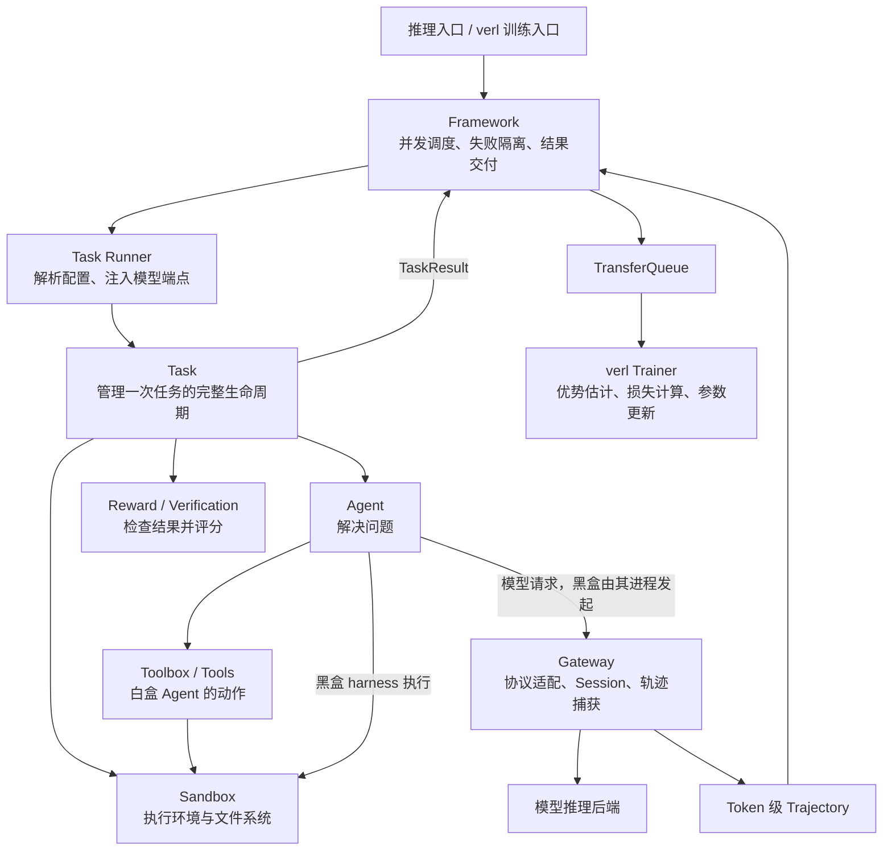
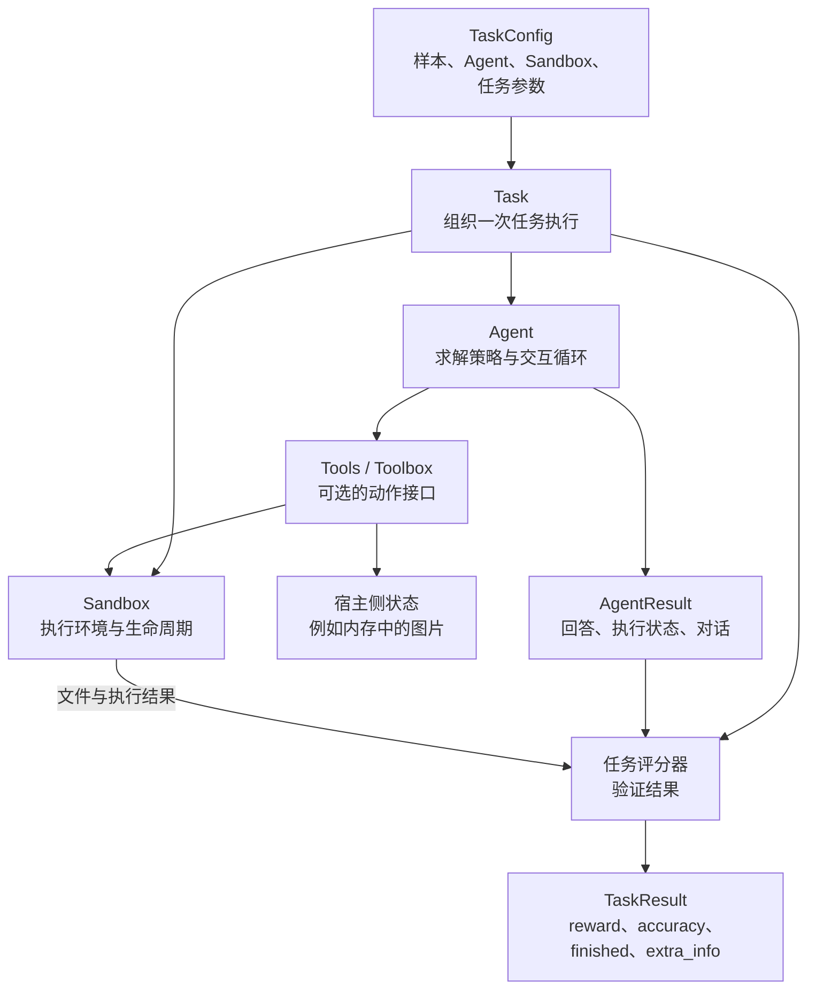
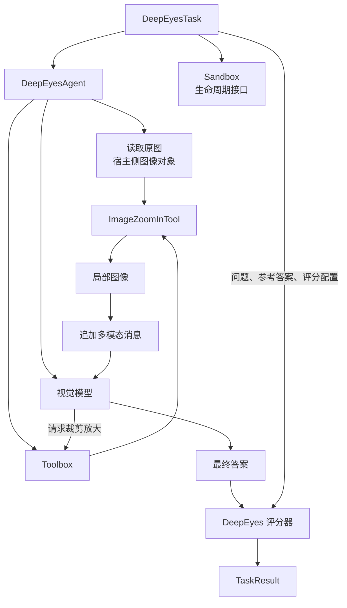
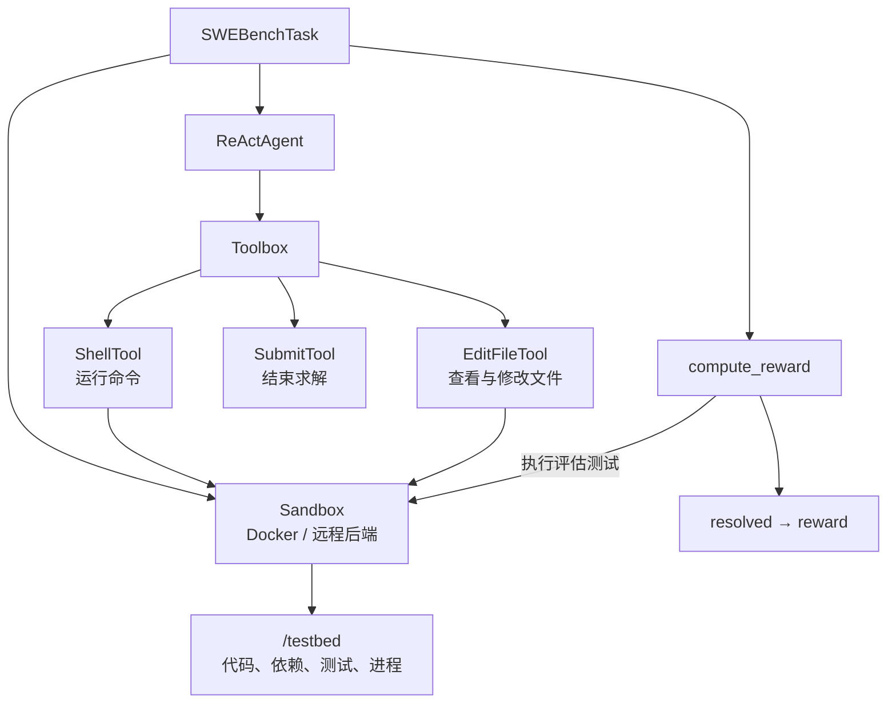
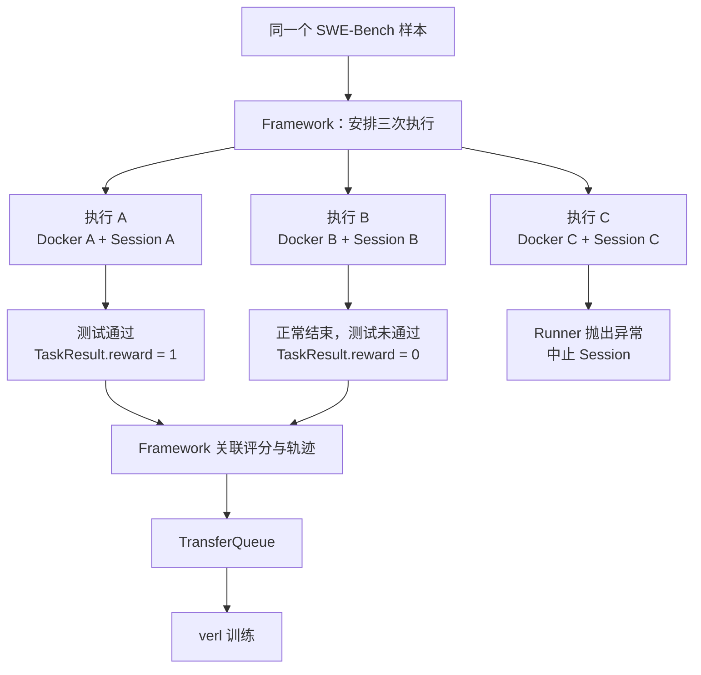
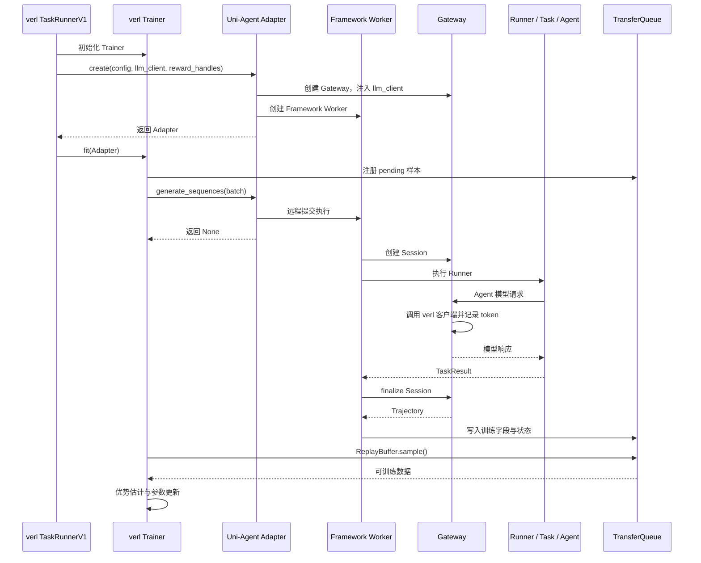
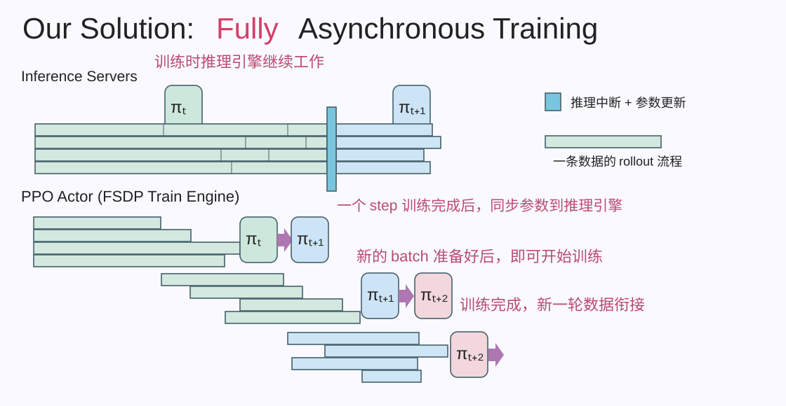

# Uni-Agent: Train Long-Horizon Agents at Scale

[Uni-Agent](https://github.com/verl-project/uni-agent) 围绕三个方向构建：

1. **白盒框架。** 提供可修改、可扩展的框架，让用户自由构建和定制 Agent，并在黑盒 Harness 尚未覆盖的方向扩展，例如 Desktop、GUI、Audio 等多模态交互，以及 Multi-Agent 系统编排。
2. **Agent Gateway。** 接入 Claude Code、Codex 等黑盒 Harness，复用训练与部署时的交互栈，减少“训练 Harness ≠ 推理 Harness”带来的性能损失。
3. **Agentic RL 优化。** 面向 128K 上下文、数百轮交互和高频工具调用，优化训练效率、资源使用、奖励与稳定性，并在 SWE-Bench Verified 上取得性能提升。

各组件分工如下：

- **Task**：定义任务、管理生命周期并计算评分。
- **Agent**：执行求解策略，与环境交互。
- **Gateway**：适配模型协议，捕获 token 级采样轨迹。
- **Framework**：编排执行，关联轨迹与任务结果，交给 verl 训练。
- **verl**：执行优势估计、损失计算与模型参数更新。

<!-- more -->

## 为什么需要 Uni-Agent

代码修复任务的一次 rollout 可能持续数百轮：

```text
阅读 issue → 搜索代码 → 修改文件 → 运行测试 → 根据报错继续修改
                                          ↓
                                验证结果 → 奖励 → 参数更新
```

它需要持续存在的文件系统、工具进程和多轮上下文。规模化训练还要处理环境回收、推理缓存、长尾任务、执行失败，以及采样记录的准确性。


| 问题 | 为什么需要处理 | 实现方向 |
| --- | --- | --- |
| 大规模环境 | 每个任务都有独立的文件、依赖和进程 | 沙箱启动、隔离、超时与回收 |
| 长上下文推理 | 工具等待期间，下一轮仍可能复用历史上下文 | 请求调度、KV cache 复用与卸载 |
| 长上下文训练 | 长轨迹增加激活与反向传播开销 | 并行、重计算与卸载 |
| Harness 接入 | 历史压缩、重试和分支会改变上下文 | 在模型调用边界采集真实 token 轨迹 |
| 有效学习 | 奖励稀疏、轨迹长、策略版本变化 | 奖励设计、信用分配与训练优化 |

图中方向不等于当前版本已全部实现。Uni-Agent 与 verl 的分工是：**Uni-Agent 组织实际任务的交互并交付训练数据；verl 负责优势估计、策略损失和分布式参数更新。**

verl 本身已有多轮 Agent Loop 接口；Uni-Agent 进一步抽出任务、工具、环境和 harness 接入的公共工程，使评测与训练可以复用同一套交互栈。

## 如何组织整体架构


项目将任务执行与模型调用拆开：环境操作经过 Sandbox，模型请求经过 Gateway。Framework 在任务结束后关联评分与轨迹。



上图展示 Gateway 管理的执行路径。普通 API 推理可直接运行 Task，让 Agent 请求外部模型服务，不必经过 Gateway 和 TransferQueue。外部 API 可用于评测；参数训练需要可更新权重的模型后端。

### 组件与目录

| 组件 / 目录 | 为什么需要 | 如何实现 |
| --- | --- | --- |
| `tasks/` | 不同任务有不同环境与成功标准 | Task 组合 Sandbox、Agent 和验证逻辑，返回 `TaskResult` |
| `agents/` | 求解策略与任务评分需要独立变化 | 自己实现交互循环，或启动外部 harness |
| `tools/` | 模型需要结构化的动作接口 | Tool 定义动作；Toolbox 绑定环境、提供 schema 并分发调用 |
| `sandbox/` | 环境部署方式不应绑定 Agent | 统一命令执行、文件操作和生命周期接口 |
| `gateway/` | 兼容已有模型 API，并准确采集训练轨迹 | 协议适配、Session 管理、消息编解码和 token 缓冲 |
| `framework/` | 并发执行和训练数据交付需要统一组织 | 调度 Runner、隔离失败、关联奖励、写入 TransferQueue |
| `agent_aware_router/` | 多推理副本的负载和缓存状态不同 | 采集状态，由路由策略选择副本 |
| `logging/`、`rl_insight/` | 长任务和分布式执行难以定位问题 | 日志上下文、运行产物、观测信号与追踪 |
| `examples/`、`tests/`、`docs/` | 配置与行为需要可复现、可验证 | 运行配方、回归测试和使用说明 |

## 任务执行：Task、Agent、Tool 与 Sandbox

### 为什么要拆分这些职责

同一个代码修复任务可以使用 ReAct 或 Claude Code，也可以运行在 Docker 或远程沙箱。任务评分、求解策略和基础设施各自变化，因此分别由 Task、Agent 和 Sandbox 管理。


### 如何执行一次任务

内置 SWE-Bench Task 的主流程如下：

```text
SWEBenchTask.run()
│
├── build_sandbox()
│   └── 根据 provider 创建 Sandbox
│
├── Sandbox.__aenter__()
│   └── 启动环境
│
├── build_agent()
│   └── 根据 agent.name 创建 Agent
│
├── agent.run(sandbox, messages, workdir)
│   └── 在 /testbed 中修复代码
│
├── compute_reward(sample, sandbox)
│   └── 运行测试并解析 resolved
│
├── 构造 TaskResult
│
└── Sandbox.__aexit__()
    └── 停止环境，然后返回结果
```

Task 管理 Sandbox 生命周期；Agent 和评分器使用同一个已启动的环境。上述调用树展示默认的 Agent 求解路径；Oracle 模式会跳过 Agent，直接应用标准补丁后评分。

`TaskResult` 的字段各有用途：

- `reward`：任务结果奖励。
- `accuracy`：评估准确率。
- `finished`：是否正常完成，允许 `True`、`False` 或未报告的 `None`。
- `extra_info`：评估报告、错误等结构化上下文，不直接作为聚合指标。

### Task 如何调用不同 Agent

`Task.run()` 组织任务环境、Agent 执行和结果验证，再通过统一的 `agent.run(sandbox, messages, workdir)` 接口调用不同 Agent。具体的推理与工具交互过程由各 Agent 实现。

以白盒 ReAct Agent 为例，`agent.run()` 内部的流程是：

```text
Task 调用 agent.run()
    → 创建 Toolbox 和模型客户端
    → 初始化 transcript（交互历史）
    → 循环调用 step()
        ├── 将 transcript 发给模型
        ├── 将模型回复加入 transcript
        ├── 执行工具调用
        └── 将工具结果加入 transcript
    → 满足停止条件
    → 清理工具与模型客户端
    → 返回 AgentResult
```

Task 获得 `AgentResult` 后继续验证任务并返回 `TaskResult`。替换 Agent 时，Task 可以复用相同的任务环境和评分逻辑；ReAct 在框架内执行上述循环，黑盒 Agent 则可以启动外部 harness，由它管理内部交互。

接入 RL 时，Gateway 捕获模型调用对应的 token 轨迹，Framework 组织任务执行并关联轨迹与评分，再将训练记录交给 verl。因此，同一套任务与 Agent 执行逻辑可以用于推理评测和 RL rollout。

### 白盒与黑盒 Agent

| 类型 | 如何运行 | 示例 |
| --- | --- | --- |
| 白盒 | Uni-Agent 控制模型请求、工具调用、上下文和停止条件 | ReAct、MemAgent |
| 黑盒 | 通过 Sandbox 启动外部进程，由 harness 控制内部循环 | Claude Code、Codex、OpenClaw |

ReAct 的两条调用路径是：

```text
模型决策：Agent → Gateway → 模型后端
环境执行：Agent → Toolbox → Tool → Sandbox
```

工具结果加入消息后，Agent 再次请求模型。Toolbox 负责参数校验、动作分发和工具生命周期。黑盒 harness 通常使用自己的工具系统，不必经过 Uni-Agent 的 Toolbox。

Sandbox 提供 `exec()`、`read_file()`、`write_file()` 等接口。Docker 提供本地容器隔离，Modal、veFaaS、E2B 等提供远程环境；`local` 直接执行宿主机命令，不提供隔离。

### 白盒扩展：为不同任务接入不同模态

白盒框架允许用户直接组合 Task、Agent、Tools 和 Sandbox，定制模型如何观察环境、调用工具并接收反馈。统一的是组件之间的职责与接口；不同任务仍需要自己的观察表示、动作实现和评分逻辑。

#### 通用结构：Task 组织执行，Agent 实现求解

用户先在 `TaskConfig` 中选择 Agent、Sandbox 和任务参数，并提供对应的样本数据。Task 负责组织执行和评分；Agent 负责模型交互与求解策略；Tools 按需操作沙箱或宿主侧状态。



这里的样本与配置表示任务输入的整体组合，不要求所有数据都直接存入同一个配置对象。评分器也可以是 Task 内部的方法，不一定是独立组件。**工具不必全部经过 Sandbox**：图像裁剪等操作可以处理宿主内存中的状态，代码执行则通常需要沙箱环境。

#### 图像任务：DeepEyes 的裁剪与放大循环

以 DeepEyes 图像问答为例，多模态接入需要将图像观察纳入模型上下文，并让工具产生新的视觉观察。下面展示其任务组织方式：



Agent 将原图与问题提供给视觉模型。模型需要观察细节时，Toolbox 分发裁剪放大请求，`ImageZoomInTool` 生成局部图像，再作为多模态消息加入上下文。模型可以据此继续调用工具或给出最终答案，Task 再按参考答案与评分配置组织验证。

这个例子中，图像工具处理宿主侧图像对象；Sandbox 的生命周期接口与实际承载图像处理的位置可以分开。图中的模型调用与评分结果回传为简化表示，实际仍由 Agent 和 Task 组织。

#### 代码任务：SWE-Bench 的文件与进程交互

代码修复面对的观察与动作不同：Agent 需要读取文件、修改代码、执行命令，环境状态主要由 Sandbox 中的仓库和进程承载。



图中的 Shell、Editor 和 Submit 表示工具职责，具体类名与注册名称由实现决定。Agent 求解结束后，Task 在同一个任务环境中运行评估测试，将 `resolved` 等验证结果转换为任务奖励。

对比两个任务，接入新模态需要明确三件事：**Agent 如何构造模型输入，工具如何产生下一步观察，Task 如何判断结果是否正确。** 框架复用任务组织、工具接口和环境管理；模型服务还需要支持相应模态，Gateway 的编码与轨迹路径也需要与之兼容。完成这些接入后，再由 Framework 将任务执行与 verl 的 rollout 请求连接起来。

### 如何通过配置组合组件

```yaml
- name: swe_bench
  sandbox:
    provider: docker
  agent:
    name: react
    tools:
      - name: stateful_shell
      - name: str_replace_editor
      - name: submit
```

从 [`SWEBenchTask`](https://github.com/verl-project/uni-agent/blob/main/uni_agent/tasks/swe_bench/task.py) 开始读，重点理解一句话：

**它将“一个代码修复样本、一个执行环境、一个 Agent 和一个测试评分器”组装成一次完整任务。**

当前阅读版本的整个文件只有 74 行，主流程是：

```text
读取任务配置
    → 启动 Sandbox
    → Agent 修改代码，或直接应用标准补丁
    → 在同一 Sandbox 中运行评估
    → 生成 TaskResult
    → 清理 Sandbox 后返回
```

具体看 `run()`：从 `cfg.metadata` 取出样本，用 `async with self.build_sandbox()` 管理环境；通常调用 `agent.run(..., workdir="/testbed")` 修复代码，Oracle 模式则直接应用样本中的标准补丁。随后调用 `compute_reward()` 运行评估，将 `resolved` 转成 `reward` 和 `accuracy`，并返回 `TaskResult`。退出 `async with` 时先清理环境，再把结果交给调用方。

## Gateway：从 Messages 到训练轨迹

### 为什么需要 Gateway

已有 harness 包含自己的提示词、工具、记忆和重试逻辑。通过兼容的模型 API 接入，可以保留这些行为，并在模型调用边界记录训练数据。

最终对话文本不足以还原真实采样：重新 tokenize 可能改变 token 序列，历史压缩、分支和工具上下文也不能直接拼接。Gateway 因此保存实际生成的 token、mask 和 log probability。


### 如何处理模型请求

```text
GatewayManager
    管理 Gateway actor 池，定位 Session 所属 actor
        ↓
GatewayActor（gateway.py）
    接收 HTTP 请求，管理 Session 与 policy 绑定
        ↓
Adapters
    将 OpenAI / Anthropic 请求转换为内部格式
        ↓
GatewaySession + MessageCodec
    管理多轮上下文、编码模型输入、记录采样 token
        ↓
模型后端
    生成结果返回 Session，再由 Adapter 包装成 JSON / SSE
```

`gateway.py` 是服务入口，主要路由包括：

```text
/sessions/{session_id}/v1/chat/completions
/sessions/{session_id}/v1/responses
/sessions/{session_id}/v1/messages
```

以 `_handle_openai_chat_completions()` 为例：

1. 根据 `session_id` 找到 Session 和绑定的 policy。
2. Adapter 转换请求，处理采样参数与覆盖权限。
3. `session.run_generation()` 调用对应后端并记录轨迹。
4. Adapter 将结果包装为普通响应或流式响应。

多轮状态主要位于 `session/session.py`，消息编解码位于 `session/codec.py`。Gateway 本身不执行工具；token 的实际生成由模型后端完成。

### 如何表示训练轨迹

`SessionHandle` 向 Runner 提供 `session_id` 和会话专属 `base_url`。任务结束后，`finalize_session()` 返回一条或多条 `Trajectory`；异常时调用 `abort_session()`。

| `Trajectory` 字段 | 用途 |
| --- | --- |
| `prompt_ids` | 轨迹初始输入 token |
| `response_ids` | 模型输出与后续插入的上下文 token |
| `response_mask` | 区分模型输出与插入上下文 |
| `response_logprobs` | 与后续序列对齐的采样 log probability |
| `reward_score`、`reward_metrics` | Framework 或奖励 Worker 附加的评分信息 |
| `finished` | Framework 附加的任务完成状态 |
| `multi_modal_data` | 多模态输入数据 |

例如：

```text
后续序列：模型工具调用 → 工具返回结果 → 模型继续生成
mask：         1              0              1
```

`response_ids` 不全是需要计算策略损失的模型输出。工具结果属于后续上下文，通过 mask 区分。

一个 Session 可以包含多条轨迹：上下文压缩、改写或分支可能使后续调用无法延续原来的 token 链。项目提供 Chain 与 Tree 两种轨迹组织方式，最终都输出统一的 `Trajectory`。

## Framework：对接 verl 的任务分发与结果回收

### 为什么需要独立编排层

Framework 对接 verl 的 rollout 请求，将任务样本分发给 Agent 执行推理和环境交互，再把执行产生的轨迹与评分组织成训练记录，交回 verl。它连接的是双向流程：

```text
verl 提供任务样本与 rollout 配置
    → Framework 创建 Session、调度 Runner
    → Task 调用 Agent 执行推理与环境交互
    → Gateway 记录采样轨迹，Task 返回评分
    → Framework 关联轨迹与评分，交回 verl 训练
```

这里下发的是任务样本与执行配置，不是梯度或优化器状态。Task 负责一次任务的执行与验证；Framework 则负责批量任务的分发、并发限制、会话失败隔离和结果回收。异步训练还需要让 rollout 和参数更新独立推进。

**Gateway 解决“模型调用如何变成准确的训练轨迹”；Framework 解决“如何接收 verl 的任务样本、组织 Agent 执行，再把轨迹与评分交回训练系统”。**

两层分开，是因为它们管理的状态不同：

- Gateway 关注一次次模型请求，以及这些请求之间的上下文关系。
- Framework 关注一个个任务执行，以及样本、会话、奖励和训练记录之间的关系。

### 如何串起调用链

```text
verl 的 rollout 请求 / 独立推理入口
    → 任务样本与执行配置
    → AgentFrameworkRolloutAdapter
    → AgentFrameworkWorker / GatewayAgentFramework
    → 创建 Gateway Session
    → Agent Runner（默认 run_task）
    → TaskConfigResolver → Task.run()
    → agent.run() 执行推理与环境交互
    → 返回 TaskResult
    → finalize Session，获得 Trajectory
    → 轨迹选择与后处理、奖励衔接
    → 写入 TransferQueue
    → verl 读取数据并训练
```

关键代码入口：

| 文件 | 作用 |
| --- | --- |
| `framework/entry.py` | 创建 Gateway Manager 和 Framework Worker，对接 verl rollout 接口 |
| `framework/framework.py` | 批量调度、并发限制、会话执行、轨迹处理与数据交付 |
| `framework/task_runner.py` | 解析样本配置，注入 Session 模型端点并运行 Task |
| `gateway/manager.py` | 管理 Gateway actor 池和 Session 归属 |

任务评分与采样数据来自两个入口：

```text
TaskResult：reward、accuracy、finished、评估详情
Trajectory：token、mask、logprob、多模态数据
                         ↓
                 Framework 关联两者
```

最终奖励取决于配置：Framework 可使用 Runner 奖励，也可交给 verl Reward Loop Worker 处理。TransferQueue 解耦 rollout 与训练，Trainer 从队列读取完成记录，再进行优势估计、损失计算和参数更新。

### 同一样本的多次执行与失败隔离

以同一个 SWE-Bench 样本采样三次为例，每次执行使用独立的 Docker 沙箱和 Gateway Session。下图假设直接使用 Task 返回的二元测试奖励：



执行 A 和 B 都正常返回任务结果：A 的修复通过测试，B 的修复未通过测试。**任务失败仍然可以产生有效训练数据**，因此 B 的零奖励轨迹也可以交给训练侧。

执行 C 属于运行异常，Framework 中止对应 Session，不能简单将它等同于一次零奖励的正常执行。单个 Session 失败不会直接丢弃同一样本其他正常会话的结果；图中 A、B 的结果仍可进入后续训练流程。

## Router 与运行观测

### 为什么需要

多轮任务在工具执行期间暂停模型调用，再次请求时可能复用已有 KV cache。多副本环境还存在负载差异，单纯均分请求未必能获得最佳吞吐。

### 如何实现

`agent_aware_router/` 通过 collectors 收集状态，由 store 保存，再由策略选择推理副本。它负责请求落到哪个副本；Gateway 负责请求属于哪个 Session，以及如何记录轨迹。

`logging/` 提供共享日志上下文与运行产物，`rl_insight/` 接入观测信号。它们帮助关联任务、会话和训练阶段，定位长尾与失败。

## 如何接入 verl

Uni-Agent 通过 verl 已有的 `agent_loop_manager_class` 扩展点接入，接管 Agent rollout 的执行与结果交付，继续复用 verl 的模型服务、ReplayBuffer、优势估计、参数更新和权重同步。

以下调用链基于本项目锁定的 verl 子模块版本 `2bc6ac46043e31855cea194236ff7548c91817c8`。

### 为什么通过 AgentLoopManager 接入

Trainer 需要提交一批样本，并获得符合训练契约的数据，但不需要了解具体 Agent 如何调用工具、使用哪种沙箱。将执行入口与训练算法分开，可以在保留训练流程的同时替换任务与 harness。

这一扩展点包含两部分契约：

- **控制接口**：提供 `create(...)` 工厂入口和 `generate_sequences(batch)` 方法。
- **数据接口**：将 rollout 结果按 verl 所需字段和状态写入 TransferQueue。

Uni-Agent 的适配器不继承默认 `AgentLoopManagerTQ`，而是提供兼容的调用接口。训练数据通过队列交付，不通过 `generate_sequences()` 的返回值交付。

### 配置与初始化

训练脚本指定适配器的完整 Python 类路径：

```bash
trainer.use_v1=True \
trainer.v1.trainer_mode=colocate_async \
++actor_rollout_ref.rollout.agent.agent_loop_manager_class=uni_agent.framework.entry.AgentFrameworkRolloutAdapter
```

两个配置相互独立：`trainer_mode` 选择训练调度方式，`agent_loop_manager_class` 选择 rollout 执行入口。

verl 的 `TaskRunnerV1.run()` 依次初始化 TransferQueue、Trainer 和 AgentLoopManager，再调用 `trainer.fit(manager)`。这里的 `TaskRunnerV1` 启动整个训练作业，与 Uni-Agent 执行单个样本的 `run_task()` 不同。

`init_agent_loop_manager()` 动态加载配置中的类；未配置时使用默认 `AgentLoopManagerTQ`。随后调用：

```python
manager = agent_loop_manager_cls.create(
    config=config,
    llm_client=trainer.get_llm_client(),
    teacher_client=trainer.get_teacher_client(),
    reward_loop_worker_handles=trainer.get_reward_handles(),
)
```

`AgentFrameworkRolloutAdapter.create()` 创建两组组件：

```text
AgentFrameworkRolloutAdapter
├── GatewayManager
│   └── GatewayActor 池：使用 verl 注入的 llm_client
└── AgentFrameworkWorker（Ray actor）
    └── GatewayAgentFramework：调度 Runner、处理轨迹与奖励
```

Gateway 的模型后端直接使用 Trainer 提供的客户端，因此可以继承对应训练模式的生成行为。奖励 Worker 句柄也由 verl 注入；当前适配器不支持非空的 `teacher_client`。

### 样本提交与训练数据交付

Trainer 为样本分配 `uid`、注册 TransferQueue 的 `pending` 状态，然后调用：

```python
agent_loop_manager.generate_sequences(batch)
```

适配器将请求转发给 Framework Worker，立即返回 `None`：

```python
self.framework_worker.generate_sequences.remote(prompts)
```

Framework 创建 Session，调用配置中的 Runner。默认 `run_task()` 解析配置并运行 Task；Agent 的模型请求经过 Gateway，最终调用 verl 的 `llm_client.generate()`。



图中模型请求可能重复多轮；ReplayBuffer 也可能提前开始等待数据，图示表达依赖关系，不表示异步执行的唯一时间顺序。

Framework 将轨迹转换为 verl 的数据契约：

| Uni-Agent 数据 | TransferQueue 字段 |
| --- | --- |
| `prompt_ids`、`response_ids` | `prompts`、`responses`，并构造 `input_ids` 等张量 |
| `response_mask` | `response_mask`、`loss_mask` |
| `response_logprobs` | `rollout_log_probs` |
| 标量 `reward_score` | `rm_scores`，放在最后一个 response 位置 |
| 采样权重版本范围 | `min_global_steps`、`max_global_steps` 标签 |

Trainer 从 ReplayBuffer 获取可采样记录，再使用原有训练流程。最终奖励仍受奖励拓扑配置影响，例如后续 colocated reward pass 可能重新计算 `rm_scores`。

源码入口：

- `verl/verl/trainer/main_ppo.py`：动态加载并创建 rollout 管理器。
- `uni_agent/framework/entry.py`：适配器、Gateway 与 Framework Worker 的组装。
- `uni_agent/framework/framework.py`：执行任务并转换、写入训练记录。
- `verl/verl/trainer/ppo/v1/trainer_base.py`：提交样本、从 ReplayBuffer 采样并训练。

### 如何利用 verl：Fully Async 与 Partial Rollout 缓解长尾

#### 为什么需要

Agent 任务的交互轮数与工具耗时差异很大。同步训练必须等待整批 rollout 完成，少量长任务就可能让其他资源空闲。异步训练消费已完成的样本组，未完成任务跨更新继续执行，从而减少整批同步屏障带来的等待。



*根据演示截图复刻。横条表示单条数据的 rollout；暂停与参数同步的具体范围取决于训练模式。*

三个概念需要分开：

| 概念 | 决定什么 |
| --- | --- |
| Colocate | 训练与推理是否共享 GPU |
| Fully Async | 采样与训练是否独立推进、持续重叠 |
| Partial Rollout | 未完成生成能否在中断后保留 token 前缀并继续 |

Colocate Async 同样支持 Partial Rollout。它不是始终在同一组 GPU 上同时训练和推理，而是让任务状态持续存在，GPU 在不同阶段切换用途。

#### Colocate Async 如何切换

`PPOTrainerColocateAsync.get_llm_client()` 返回 `FullyAsyncLLMServerClient`，经适配器注入 Gateway。当 ReplayBuffer 凑够当前更新需要的数据时：

```text
on_sample_end()
    → abort_replicas()：中断未完成生成并暂停接收处理
    → sleep_replicas()：释放推理权重和 KV cache 设备内存
    → Trainer 执行参数更新
    → on_step_end()
    → update_weights(global_steps)
    → resume_generation_replicas()
```

未完成任务的 Sandbox、消息和 Gateway Session 可以继续保留。释放 KV cache 不等于丢弃任务；恢复时可以根据保留的 token 重新 prefill。

#### Partial Rollout 如何续生成

`FullyAsyncLLMServerClient.generate()` 在内部累积输出。一次底层生成被中断后，它保留已生成 token 与对应 logprob，以“原 prompt + 已生成 token”再次请求，并扣减剩余生成预算。

```text
θ₀：prompt → 生成前 300 token → 被中断
                         ↓
                  训练并同步 θ₁
                         ↓
θ₁：prompt + 前 300 token → 生成剩余部分
                         ↓
                合并 token 与各自的 logprob
```

ReAct 仍然只等待一次 `model.query()`；中断与续生成被 verl 客户端隐藏，Gateway 获得合并后的输出。因此黑盒 harness 也不需要自行实现恢复逻辑，但 HTTP 超时必须能容纳等待时间。

这里的 Partial Rollout **不表示未完成前缀立即参与训练**。当前 Uni-Agent Framework 正常路径仍等待 Runner 返回，再 finalize Session 并交付轨迹。它也不同于上下文压缩导致的轨迹拆分，或 `mask_unfinished_episode` 的损失掩码。

#### Separate Async 如何持续重叠

`PPOTrainerSeparateAsync` 使用独立 rollout 资源池，让推理与训练重叠；同步权重仍需协调，并非永不暂停。它还支持将空闲训练 GPU 临时切换为推理副本：

```text
数据不足：训练 GPU 临时参与 rollout → 加入负载均衡器
数据足够：移出路由 → 中断局部生成 → sleep → 返回训练
```

禁用 `actor_rollout_ref.hybrid_engine` 后，只由独立推理池提供 rollout。具体资源、批量和同步后端必须匹配所选模式。

#### 长尾仍受组与策略滞后约束

例如 A、B 样本组已结束，C 仍在运行：Trainer 可以使用足够的已完成组更新参数，C 的模型请求随后使用新权重继续，无需重做已完成的工具操作。但当前 Framework 会等待同一个 prompt 的各 Session 返回后写入结果，因此同组长尾仍可能阻塞该组发布。

异步也引入策略滞后：同一条轨迹可能跨多个权重版本。Gateway 保留真实采样 logprob 和版本跨度；verl 的 `ReplayBufferAsync` 根据配置淘汰过旧的已完成组（`drop`），或在在途任务达到阈值时等待它们完成（`wait`）。算法侧再根据配置进行重要性修正等处理。

相关源码：

- `verl/verl/trainer/ppo/v1/trainer_colocate_async.py`：采样结束与 step 结束的调度回调。
- `verl/verl/trainer/ppo/v1/trainer_separate_async.py`：独立推理池与角色切换。
- `verl/verl/workers/rollout/llm_server.py`：`FullyAsyncLLMServerClient` 中断续生成。
- `verl/verl/checkpoint_engine/base.py`：推理副本暂停、显存释放、权重同步与恢复。
- `verl/verl/trainer/ppo/v1/replay_buffer.py`：可采样组选择与滞后控制。

## 源码阅读顺序

先追踪一条任务，再理解分布式编排：

1. `tasks/swe_bench/task.py`：Task 如何组合环境、Agent 和评分。
2. `agents/react/agent.py`：模型与工具的交互循环。
3. `tools/base.py`、`sandbox/docker.py`：动作如何落到环境。
4. `framework/task_runner.py`、`tasks/config.py`：样本与配置如何进入任务。
5. `gateway/gateway.py`：一次模型请求的服务入口。
6. `gateway/session/session.py`、`codec.py`：上下文与 token 轨迹。
7. `framework/framework.py`、`entry.py`：并发、失败处理和训练衔接。

## 参考资料

- [Uni-Agent 官方文档](https://uni-agent.readthedocs.io/en/latest/)
