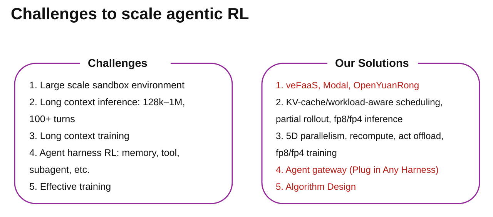
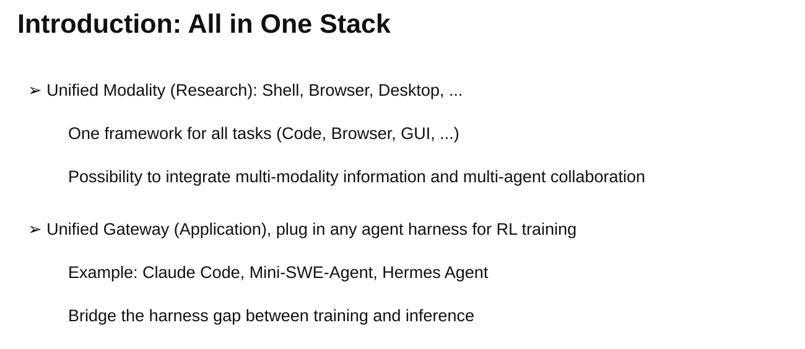
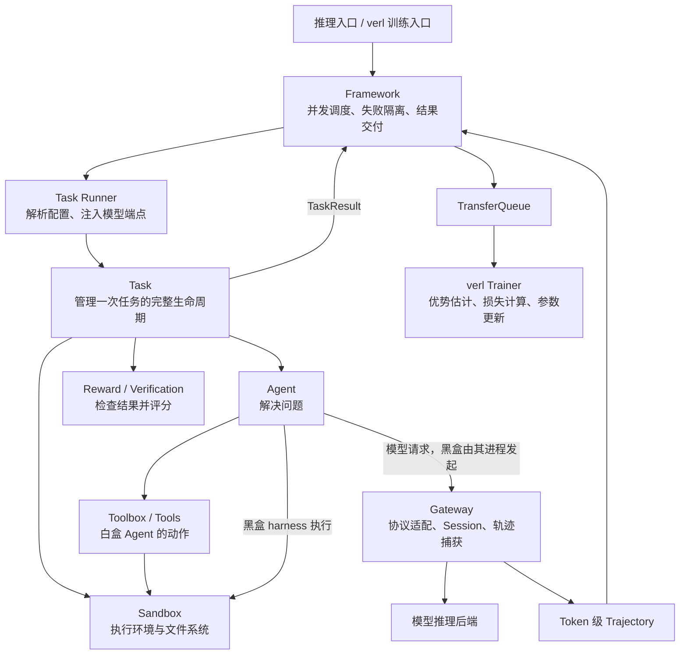
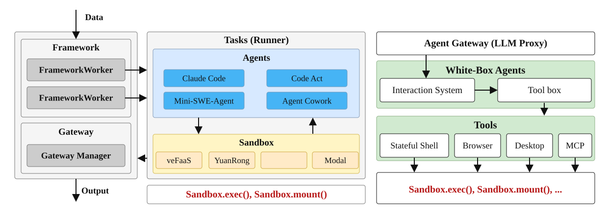
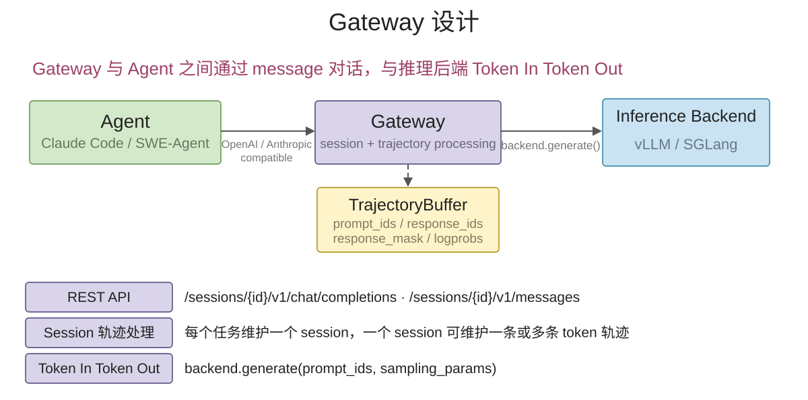

# Uni-Agent: Train Long-Horizon Agents at Scale

[Uni-Agent](https://github.com/verl-project/uni-agent) 将 Agent 执行、任务环境、轨迹采集和强化学习连接起来：Task 定义任务与评分，Agent 与环境交互，Gateway 捕获模型采样轨迹，Framework 将结果交给 verl 训练。

<!-- more -->

## 为什么需要 Uni-Agent

代码修复任务的一次 rollout 可能持续数百轮：

```text
阅读 issue → 搜索代码 → 修改文件 → 运行测试 → 根据报错继续修改
                                          ↓
                                验证结果 → 奖励 → 参数更新
```

它需要持续存在的文件系统、工具进程和多轮上下文。规模化训练还要处理环境回收、推理缓存、长尾任务、执行失败，以及采样记录的准确性。



| 问题 | 为什么需要处理 | 实现方向 |
| --- | --- | --- |
| 大规模环境 | 每个任务都有独立的文件、依赖和进程 | 沙箱启动、隔离、超时与回收 |
| 长上下文推理 | 工具等待期间，下一轮仍可能复用历史上下文 | 请求调度、KV cache 复用与卸载 |
| 长上下文训练 | 长轨迹增加激活与反向传播开销 | 并行、重计算与卸载 |
| Harness 接入 | 历史压缩、重试和分支会改变上下文 | 在模型调用边界采集真实 token 轨迹 |
| 有效学习 | 奖励稀疏、轨迹长、策略版本变化 | 奖励设计、信用分配与训练优化 |

图中方向不等于当前版本已全部实现。Uni-Agent 与 verl 的分工是：**Uni-Agent 组织实际任务的交互并交付训练数据；verl 负责优势估计、策略损失和分布式参数更新。**

verl 本身已有多轮 Agent Loop 接口；Uni-Agent 进一步抽出任务、工具、环境和 harness 接入的公共工程，使评测与训练可以复用同一套交互栈。

## 如何组织整体架构



项目将任务执行与模型调用拆开：环境操作经过 Sandbox，模型请求经过 Gateway。Framework 在任务结束后关联评分与轨迹。



上图展示 Gateway 管理的执行路径。普通 API 推理可直接运行 Task，让 Agent 请求外部模型服务，不必经过 Gateway 和 TransferQueue。外部 API 可用于评测；参数训练需要可更新权重的模型后端。

### 组件与目录

| 组件 / 目录 | 为什么需要 | 如何实现 |
| --- | --- | --- |
| `tasks/` | 不同任务有不同环境与成功标准 | Task 组合 Sandbox、Agent 和验证逻辑，返回 `TaskResult` |
| `agents/` | 求解策略与任务评分需要独立变化 | 自己实现交互循环，或启动外部 harness |
| `tools/` | 模型需要结构化的动作接口 | Tool 定义动作；Toolbox 绑定环境、提供 schema 并分发调用 |
| `sandbox/` | 环境部署方式不应绑定 Agent | 统一命令执行、文件操作和生命周期接口 |
| `gateway/` | 兼容已有模型 API，并准确采集训练轨迹 | 协议适配、Session 管理、消息编解码和 token 缓冲 |
| `framework/` | 并发执行和训练数据交付需要统一组织 | 调度 Runner、隔离失败、关联奖励、写入 TransferQueue |
| `agent_aware_router/` | 多推理副本的负载和缓存状态不同 | 采集状态，由路由策略选择副本 |
| `logging/`、`rl_insight/` | 长任务和分布式执行难以定位问题 | 日志上下文、运行产物、观测信号与追踪 |
| `examples/`、`tests/`、`docs/` | 配置与行为需要可复现、可验证 | 运行配方、回归测试和使用说明 |

## 任务执行：Task、Agent、Tool 与 Sandbox

### 为什么要拆分这些职责

同一个代码修复任务可以使用 ReAct 或 Claude Code，也可以运行在 Docker 或远程沙箱。任务评分、求解策略和基础设施各自变化，因此分别由 Task、Agent 和 Sandbox 管理。



*该图由演示截图复刻，右侧是白盒 Agent 的局部展开。图中的工具与后端名称表示扩展方向，具体支持范围以代码为准。*

### 如何执行一次任务

内置 SWE-Bench Task 的主流程如下：

```python
async with self.build_sandbox() as sandbox:
    agent = self.build_agent()
    agent_result = await agent.run(
        sandbox=sandbox,
        messages=self.config.prompt,
        workdir="/testbed",
    )
    result = await compute_reward(self.config.metadata, sandbox)

return TaskResult(
    reward=float(result["resolved"]),
    accuracy=float(result["resolved"]),
    finished=agent_result.finished,
    extra_info=result,
)
```

这是省略日志和分支后的主干。Task 管理 Sandbox 生命周期；Agent 使用已启动的环境。SWE 评分在 Sandbox 中运行测试，Task 再将结果转换为奖励。项目没有要求所有任务继承统一的 Reward 基类。

`TaskResult` 的字段各有用途：

- `reward`：任务结果奖励。
- `accuracy`：评估准确率。
- `finished`：是否正常完成，允许 `True`、`False` 或未报告的 `None`。
- `extra_info`：评估报告、错误等结构化上下文，不直接作为聚合指标。

### 白盒与黑盒 Agent

| 类型 | 如何运行 | 示例 |
| --- | --- | --- |
| 白盒 | Uni-Agent 控制模型请求、工具调用、上下文和停止条件 | ReAct、MemAgent |
| 黑盒 | 通过 Sandbox 启动外部进程，由 harness 控制内部循环 | Claude Code、Codex、OpenClaw |

ReAct 的两条调用路径是：

```text
模型决策：Agent → Gateway → 模型后端
环境执行：Agent → Toolbox → Tool → Sandbox
```

工具结果加入消息后，Agent 再次请求模型。Toolbox 负责参数校验、动作分发和工具生命周期。黑盒 harness 通常使用自己的工具系统，不必经过 Uni-Agent 的 Toolbox。

Sandbox 提供 `exec()`、`read_file()`、`write_file()` 等接口。Docker 提供本地容器隔离，Modal、veFaaS、E2B 等提供远程环境；`local` 直接执行宿主机命令，不提供隔离。

### 如何通过配置组合组件

```yaml
- name: swe_bench
  sandbox:
    provider: docker
  agent:
    name: react
    tools:
      - name: stateful_shell
      - name: str_replace_editor
      - name: submit
```

注册表根据名称选择实现。`TaskConfigResolver` 依次合并任务级默认配置与样本级配置，最后注入运行时模型端点、API key 和模型名称。嵌套字典递归合并，列表与标量由样本值覆盖；样本不能替换当前运行绑定的模型端点。

## Gateway：从 Messages 到训练轨迹

### 为什么需要 Gateway

已有 harness 包含自己的提示词、工具、记忆和重试逻辑。通过兼容的模型 API 接入，可以保留这些行为，并在模型调用边界记录训练数据。

最终对话文本不足以还原真实采样：重新 tokenize 可能改变 token 序列，历史压缩、分支和工具上下文也不能直接拼接。Gateway 因此保存实际生成的 token、mask 和 log probability。



### 如何处理模型请求

```text
GatewayManager
    管理 Gateway actor 池，定位 Session 所属 actor
        ↓
GatewayActor（gateway.py）
    接收 HTTP 请求，管理 Session 与 policy 绑定
        ↓
Adapters
    将 OpenAI / Anthropic 请求转换为内部格式
        ↓
GatewaySession + MessageCodec
    管理多轮上下文、编码模型输入、记录采样 token
        ↓
模型后端
    生成结果返回 Session，再由 Adapter 包装成 JSON / SSE
```

`gateway.py` 是服务入口，主要路由包括：

```text
/sessions/{session_id}/v1/chat/completions
/sessions/{session_id}/v1/responses
/sessions/{session_id}/v1/messages
```

以 `_handle_openai_chat_completions()` 为例：

1. 根据 `session_id` 找到 Session 和绑定的 policy。
2. Adapter 转换请求，处理采样参数与覆盖权限。
3. `session.run_generation()` 调用对应后端并记录轨迹。
4. Adapter 将结果包装为普通响应或流式响应。

多轮状态主要位于 `session/session.py`，消息编解码位于 `session/codec.py`。Gateway 本身不执行工具；token 的实际生成由模型后端完成。

### 如何表示训练轨迹

`SessionHandle` 向 Runner 提供 `session_id` 和会话专属 `base_url`。任务结束后，`finalize_session()` 返回一条或多条 `Trajectory`；异常时调用 `abort_session()`。

| `Trajectory` 字段 | 用途 |
| --- | --- |
| `prompt_ids` | 轨迹初始输入 token |
| `response_ids` | 模型输出与后续插入的上下文 token |
| `response_mask` | 区分模型输出与插入上下文 |
| `response_logprobs` | 与后续序列对齐的采样 log probability |
| `reward_score`、`reward_metrics` | Framework 或奖励 Worker 附加的评分信息 |
| `finished` | Framework 附加的任务完成状态 |
| `multi_modal_data` | 多模态输入数据 |

例如：

```text
后续序列：模型工具调用 → 工具返回结果 → 模型继续生成
mask：         1              0              1
```

`response_ids` 不全是需要计算策略损失的模型输出。工具结果属于后续上下文，通过 mask 区分。

一个 Session 可以包含多条轨迹：上下文压缩、改写或分支可能使后续调用无法延续原来的 token 链。项目提供 Chain 与 Tree 两种轨迹组织方式，最终都输出统一的 `Trajectory`。

## Framework：将执行结果交给 verl

### 为什么需要独立编排层

Task 的职责是完成一个任务；训练需要对一批样本并发采样，隔离单个会话的失败，并将任务评分与 Gateway 轨迹关联。异步训练还需要让 rollout 和参数更新独立推进。

### 如何串起调用链

```text
verl / 推理入口
    → AgentFrameworkRolloutAdapter
    → AgentFrameworkWorker / GatewayAgentFramework
    → 创建 Gateway Session
    → Agent Runner（默认 run_task）
    → TaskConfigResolver → Task.run()
    → 返回 TaskResult
    → finalize Session，获得 Trajectory
    → 轨迹选择与后处理、奖励衔接
    → 写入 TransferQueue
    → verl 读取数据并训练
```

关键代码入口：

| 文件 | 作用 |
| --- | --- |
| `framework/entry.py` | 创建 Gateway Manager 和 Framework Worker，对接 verl rollout 接口 |
| `framework/framework.py` | 批量调度、并发限制、会话执行、轨迹处理与数据交付 |
| `framework/task_runner.py` | 解析样本配置，注入 Session 模型端点并运行 Task |
| `gateway/manager.py` | 管理 Gateway actor 池和 Session 归属 |

任务评分与采样数据来自两个入口：

```text
TaskResult：reward、accuracy、finished、评估详情
Trajectory：token、mask、logprob、多模态数据
                         ↓
                 Framework 关联两者
```

最终奖励取决于配置：Framework 可使用 Runner 奖励，也可交给 verl Reward Loop Worker 处理。TransferQueue 解耦 rollout 与训练，Trainer 从队列读取完成记录，再进行优势估计、损失计算和参数更新。

Runner 异常时，Framework 中止对应 Session；单个 Session 失败不会直接丢弃同一样本其他成功会话的结果。

## Router 与运行观测

### 为什么需要

多轮任务在工具执行期间暂停模型调用，再次请求时可能复用已有 KV cache。多副本环境还存在负载差异，单纯均分请求未必能获得最佳吞吐。

### 如何实现

`agent_aware_router/` 通过 collectors 收集状态，由 store 保存，再由策略选择推理副本。它负责请求落到哪个副本；Gateway 负责请求属于哪个 Session，以及如何记录轨迹。

`logging/` 提供共享日志上下文与运行产物，`rl_insight/` 接入观测信号。它们帮助关联任务、会话和训练阶段，定位长尾与失败。

## 源码阅读顺序

先追踪一条任务，再理解分布式编排：

1. `tasks/swe_bench/task.py`：Task 如何组合环境、Agent 和评分。
2. `agents/react/agent.py`：模型与工具的交互循环。
3. `tools/base.py`、`sandbox/docker.py`：动作如何落到环境。
4. `framework/task_runner.py`、`tasks/config.py`：样本与配置如何进入任务。
5. `gateway/gateway.py`：一次模型请求的服务入口。
6. `gateway/session/session.py`、`codec.py`：上下文与 token 轨迹。
7. `framework/framework.py`、`entry.py`：并发、失败处理和训练衔接。

## 参考资料

- [Uni-Agent 项目仓库](https://github.com/verl-project/uni-agent)
- [组件职责与贡献指南](https://github.com/verl-project/uni-agent/blob/main/CONTRIBUTING.md)
- [核心抽象](https://github.com/verl-project/uni-agent/blob/main/docs/source/concepts/index.md)
- [Gateway 与轨迹](https://github.com/verl-project/uni-agent/blob/main/docs/source/concepts/gateway-and-trajectories.md)
- [Uni-Agent 官方技术介绍](https://verl-project.github.io/posts/2026-09-23-uni-agent-v0-1-0/)
- [verl Agent Loop 文档](https://verl.readthedocs.io/en/latest/advance/agent_loop.html)
