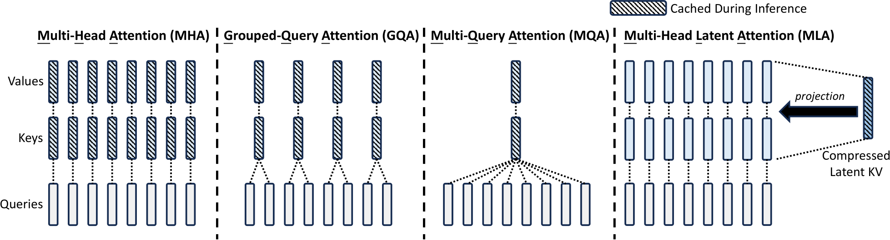

# 注意力变体与高效注意力：从 MHA、GQA 到 MLA、DSA

<!-- 在这里填写文章摘要，摘要将显示在 Blog 列表中。 -->

<!-- more -->

## 背景：为什么需要高效注意力

## MHA

## MQA：从 MHA 到 GQA

## GQA

### 把分组共享写成矩阵乘法

以 **4 个 Query 头、2 个 KV 头**为例，前两个 Query 头共享第一组 K、V，后两个 Query 头共享第二组 K、V。这里的重复是逻辑上的头映射，不要求实现中真的复制并缓存四份 KV。

<!-- 配图预留：将本节的 GQA 分组与矩阵示意图保存为 assets/attention-variants/gqa-matrix.png 后，在此插入。 -->

设输入 $X\in\mathbb{R}^{T\times d}$，每个 Key 头的维度为 $d_k$，每个 Value 头的维度为 $d_v$。GQA 先生成两组 KV：

$$
K_g=[K_1,K_2]=XW_g^K,
\qquad W_g^K\in\mathbb{R}^{d\times 2d_k},
$$

$$
V_g=[V_1,V_2]=XW_g^V,
\qquad W_g^V\in\mathbb{R}^{d\times 2d_v}.
$$

定义一个固定的分块复制矩阵：

$$
R_K=
\begin{bmatrix}
I_{d_k} & I_{d_k} & 0 & 0\\
0 & 0 & I_{d_k} & I_{d_k}
\end{bmatrix}
\in\mathbb{R}^{2d_k\times 4d_k}.
$$

于是，为四个 Query 头提供的 Key 可以统一写成：

$$
\widetilde K=[K_1,K_1,K_2,K_2]
=K_gR_K
=XW_g^KR_K.
$$

Value 的处理完全类似：

$$
R_V=
\begin{bmatrix}
I_{d_v} & I_{d_v} & 0 & 0\\
0 & 0 & I_{d_v} & I_{d_v}
\end{bmatrix},
\qquad
\widetilde V=[V_1,V_1,V_2,V_2]
=XW_g^VR_V.
$$

这就把“几个头共享同一组 KV”的结构，转成了“较窄的投影矩阵，乘上一个固定复制矩阵”。如果从完整多头投影的角度看，GQA 的等效权重是：

$$
\widetilde W^K=W_g^KR_K,
\qquad
\widetilde W^V=W_g^VR_V.
$$

它们的列块被显式绑定，例如：

$$
\widetilde W^K=
[W_1^K,W_1^K,W_2^K,W_2^K].
$$

因此，**GQA 的节省来自头间共享：同组的 Key 完全相同，Value 也完全相同。** 推理时只需要保存两组原始 KV，复制矩阵只是帮助理解等效计算。

### 合并 K、V 投影：把 GQA 写成两个矩阵的乘积

图中又向前走了一步：不再分别计算 $XW_g^K$ 和 $XW_g^V$，而是把两组权重按列拼接，得到一次联合投影：

$$
W_{\downarrow}^{KV}=[W_g^K,W_g^V]
\in\mathbb{R}^{d\times(2d_k+2d_v)},
$$

$$
C_g^{KV}=XW_{\downarrow}^{KV}
=[K_1,K_2,V_1,V_2].
$$

<!-- 配图预留：GQA 的 KV 联合投影与矩阵分解图，建议文件名 assets/attention-variants/gqa-joint-factorization.png。 -->

其中的 $\downarrow$ 表示相对于展开后的完整多头 KV，使用较窄的中间表示；这不要求 $2d_k+2d_v$ 一定小于输入维度 $d$。

接下来，让 Key 和 Value 各自从这个联合表示中选择对应部分，并按照分组规则复制。定义：

$$
W_{\uparrow}^{K}=
\begin{bmatrix}
R_K\\
0_{2d_v\times4d_k}
\end{bmatrix}
\in\mathbb{R}^{(2d_k+2d_v)\times4d_k},
$$

$$
W_{\uparrow}^{V}=
\begin{bmatrix}
0_{2d_k\times4d_v}\\
R_V
\end{bmatrix}
\in\mathbb{R}^{(2d_k+2d_v)\times4d_v}.
$$

例如，Key 的上投影矩阵展开后就是：

$$
W_{\uparrow}^{K}=
\begin{bmatrix}
I_{d_k} & I_{d_k} & 0 & 0\\
0 & 0 & I_{d_k} & I_{d_k}\\
0_{d_v\times d_k} & 0_{d_v\times d_k} & 0_{d_v\times d_k} & 0_{d_v\times d_k}\\
0_{d_v\times d_k} & 0_{d_v\times d_k} & 0_{d_v\times d_k} & 0_{d_v\times d_k}
\end{bmatrix}.
$$

前两行块分别选择 $K_1$、$K_2$ 并复制，后两行块屏蔽 $V_1$、$V_2$。注意这里的“行”是分块矩阵的行块，维度分别为 $d_k,d_k,d_v,d_v$。

因此，GQA 的完整头表示可以写成：

$$
\boxed{
\widetilde K=XW_{\downarrow}^{KV}W_{\uparrow}^{K},
\qquad
\widetilde V=XW_{\downarrow}^{KV}W_{\uparrow}^{V}
}
$$

这正是图中矩阵乘积的含义。与 MHA 的直接投影比较：

| 结构 | 完整 Key 表示 | 完整 Value 表示 |
| --- | --- | --- |
| MHA | $XW^K$ | $XW^V$ |
| GQA 的联合投影视角 | $XW_{\downarrow}^{KV}W_{\uparrow}^{K}$ | $XW_{\downarrow}^{KV}W_{\uparrow}^{V}$ |

这里仍是原来的 GQA：$W_{\downarrow}^{KV}$ 可训练，$W_{\uparrow}^{K}$、$W_{\uparrow}^{V}$ 则是由 $I$ 和 $0$ 构成的固定选择、复制矩阵。把 K、V 合并为一次投影只是等价重写，并没有在原有 GQA 之上再减少缓存。

推广到 $n_g$ 个 KV 组和 $h$ 个 Query 头，中间宽度为：

$$
m=n_g(d_k+d_v),
\qquad
W_{\downarrow}^{KV}\in\mathbb{R}^{d\times m}.
$$

矩阵分解揭示了共享带来的秩约束。例如，在上面的两组 KV 例子中：

$$
\operatorname{rank}(\widetilde W^K)
=\operatorname{rank}(W_g^KR_K)
\leq\min(d,2d_k).
$$

因此可以从低秩分解的角度理解这种结构；但“两个矩阵相乘”本身并不等于严格低秩，还要比较中间维度、实际秩和原矩阵的最大可能秩。

### 从固定选择与复制矩阵，引出潜空间表示

现在只需要放松上面的结构约束：将固定的 $W_{\uparrow}^{K}$、$W_{\uparrow}^{V}$ 改成可学习矩阵，再把中间宽度设为可选择的潜空间维度 $d_c$。中间表示就不必显式对应 $[K_1,K_2,V_1,V_2]$，而可以学习同时服务于所有 Key、Value 头的潜在特征。

这就从 GQA 的“固定选择与复制”，走向 MLA 的“KV 联合压缩与可学习上投影”：

$$
C^{KV}=XW^{DKV},
\qquad W^{DKV}\in\mathbb{R}^{d\times d_c},
$$

$$
K^C=C^{KV}W^{UK},
\qquad W^{UK}\in\mathbb{R}^{d_c\times hd_k},
$$

$$
V=C^{KV}W^{UV},
\qquad W^{UV}\in\mathbb{R}^{d_c\times hd_v}.
$$

其中 $h$ 为 Query 头数，$d_c$ 为潜空间维度。每个头对应上投影矩阵中的不同列块，因此可以得到不同的 Key 和 Value。

**固定的头间复制 → 可学习的上投影 → K、V 联合潜空间**，这条路线可以引出 MLA 的核心思想：用低维联合表示压缩 KV。这里是架构设计上的推导思路，并不意味着任意 GQA 或 MHA 都能无损转换成指定低秩的 MLA；联合潜空间需要通过训练学习。

## MLA

### 从图中理解：共享潜在表示，但各头的 KV 不必相同

承接前面的矩阵视角，GQA 通过固定的选择与复制矩阵，让同组 Query 使用完全相同的 K、V。MLA 则将上投影改为可学习映射：**所有头共享一个低维潜在表示，但每个头可以从中得到不同的 Key 和 Value。**

<!-- 首张 MLA 联合下投影与各头上投影结构图预留，建议保存为 assets/attention-variants/mla-projection.png。图中 576 的口径见本节后文。 -->

沿着结构图自下而上读，可以分为三个步骤。以下采用行向量约定，先只讨论内容分支，并省略归一化等实现细节。

**第一步：联合下投影。** 输入 $X\in\mathbb{R}^{T\times d}$ 经过一个较窄的投影，得到：

$$
C^{KV}=XW_{\downarrow}^{KV},
\qquad
W_{\downarrow}^{KV}\in\mathbb{R}^{d\times d_c},
\qquad
C^{KV}\in\mathbb{R}^{T\times d_c}.
$$

这里 $C^{KV}$ 不再要求显式对应 GQA 中的 $[K_1,K_2,V_1,V_2]$。它是通过训练学习的联合表示，可以同时承载构造 K、V 所需的信息。

**第二步：分别上投影。** 设有 $h$ 个头，内容 Key 的每头维度为 $d_k$，Value 的每头维度为 $d_v$：

$$
K^C=C^{KV}W_{\uparrow}^{K},
\qquad W_{\uparrow}^{K}\in\mathbb{R}^{d_c\times hd_k},
$$

$$
V=C^{KV}W_{\uparrow}^{V},
\qquad W_{\uparrow}^{V}\in\mathbb{R}^{d_c\times hd_v}.
$$

将上投影按头分块：

$$
W_{\uparrow}^{K}=[W_{\uparrow,1}^{K},\ldots,W_{\uparrow,h}^{K}],
\qquad
W_{\uparrow}^{V}=[W_{\uparrow,1}^{V},\ldots,W_{\uparrow,h}^{V}].
$$

对于第 $j$ 个历史 token 和第 $i$ 个头：

$$
k_{j,i}^{C}=c_j^{KV}W_{\uparrow,i}^{K},
\qquad
v_{j,i}=c_j^{KV}W_{\uparrow,i}^{V}.
$$

由于不同头使用不同的可学习列块，图中的 $K_1,K_2,K_3,K_4$ 和 $V_1,V_2,V_3,V_4$ 可以各不相同，不再像 GQA 那样固定重复。

**第三步：多头注意力与输出投影。** 先用当前 Query 对历史 Key 计算注意力，再聚合 Value，最终得到：

$$
O=[O_1,\ldots,O_h],
\qquad
\Delta X=OW^O,
\qquad
W^O\in\mathbb{R}^{hd_v\times d}.
$$

这里图示的 $Q=XW^Q$ 用于突出 KV 压缩；完整 DeepSeek-V2 还使用了 Query 的低秩投影，并为 Query、Key 设置解耦的位置分支。[DeepSeek-V2 第 2.1 节](https://arxiv.org/html/2405.04434v5#S2.SS1)

### 对照 MHA、GQA、MQA：推理时究竟缓存什么

<figure markdown>
{ loading=lazy }
<figcaption>DeepSeek-V2 论文 Figure 3。阴影标记需要缓存的部分；MLA 右侧缓存联合潜变量，而不是所有展开后的 Key、Value。此图省略了位置分支。<a href="https://arxiv.org/html/2405.04434v5#S2.F3">原图来源</a></figcaption>
</figure>

这张对比图应关注阴影，而不只是竖条数量：

| 结构 | 头之间的共享方式 | 每层、每 token 的缓存元素数，暂忽略额外位置分支 |
| --- | --- | --- |
| MHA | 各 Query 头使用各自的 K、V | $h(d_k+d_v)$ |
| GQA | 每组 Query 共享一组 K、V | $n_g(d_k+d_v)$ |
| MQA | 所有 Query 头共享一组 K、V | $d_k+d_v$ |
| MLA | 所有头共享联合潜变量，各头使用不同上投影 | $d_c$ |

GQA、MQA 通过减少独立 KV 头数来减少缓存；MLA 则改变缓存表示，保存低维联合潜变量。**图中的多个 K、V 表示各头的逻辑表示，不意味着推理时必须把它们全部展开并长期缓存。**

### 从额外矩阵乘法到注意力算子

低秩分解表面上增加了下投影、上投影。如果每次解码都先做：

$$
K_i=C^{KV}W_{\uparrow,i}^{K},
\qquad
V_i=C^{KV}W_{\uparrow,i}^{V},
$$

再把完整 K、V 交给注意力算子，就需要反复读取历史潜变量、恢复每个头的 KV，并写出中间张量。MLA 的推理实现不必采用这条计算路径。

先忽略位置编码，设 $C^{KV}\in\mathbb{R}^{N\times d_c}$ 是历史缓存，当前 Query 矩阵为 $Q_i$，第 $i$ 个头的计算是：

$$
A_i=\operatorname{Softmax}\left(
\frac{Q_i(C^{KV}W_{\uparrow,i}^{K})^{\mathsf T}}{\sqrt{d_k}}+M
\right),
$$

$$
O_i=A_i(C^{KV}W_{\uparrow,i}^{V}).
$$

其中 $M$ 为可见性掩码，Softmax 对历史 token 维度归一化。利用结合律，可以改成：

$$
\widehat Q_i=Q_i(W_{\uparrow,i}^{K})^{\mathsf T},
\qquad
A_i=\operatorname{Softmax}\left(
\frac{\widehat Q_i(C^{KV})^{\mathsf T}}{\sqrt{d_k}}+M
\right),
$$

$$
Z_i=A_iC^{KV},
\qquad
O_i=Z_iW_{\uparrow,i}^{V}.
$$

现在历史 Key 和 Value 都由同一份 $C^{KV}$ 提供：前者参与分数计算，后者参与加权聚合；各头仍有各自的 Query 和注意力分布。无需先为全部历史 token 显式恢复 $K_i$、$V_i$。

!!! note "算子融合与矩阵吸收是两个层次"
    **矩阵吸收**改变线性映射的组合方式，用结合律合并权重或转移投影位置；**算子融合**则是在实现中，将缓存读取、分数计算、在线 Softmax 和加权聚合等操作组织进更少的 GPU kernel，减少中间结果的写回。代数上可合并，不代表实现必须物化合并后的大权重，也不代表所有计算会变成一个 kernel。

例如，面向低维缓存的注意力 kernel 可以分块读取 $C^{KV}$，计算 $\widehat Q_i(C^{KV})^{\mathsf T}$，用在线 Softmax 更新归一化统计量，再累积 $Z_i$，从而不把完整分数矩阵和概率矩阵写回显存。这里是在解释可行的计算组织，不代表任意现成的注意力算子都直接支持这些维度与共享方式。

### Q/K 侧吸收：把 Key 上投影合入 Query 投影

第一张图进一步把 Query 也写成低秩投影。为避免与 KV 潜变量混淆，令 Query 潜空间维度为 $d_q$：

$$
C^Q=XW_{\downarrow}^{Q},
\qquad
W_{\downarrow}^{Q}\in\mathbb{R}^{d\times d_q},
$$

$$
Q_i=C^QW_{\uparrow,i}^{Q},
\qquad
W_{\uparrow,i}^{Q}\in\mathbb{R}^{d_q\times d_k}.
$$

为突出线性部分，暂省略潜变量归一化；实现中若存在归一化，不能把权重直接穿过这个非线性操作合并。代入分数计算：

$$
Q_iK_i^{\mathsf T}
=C^QW_{\uparrow,i}^{Q}
\left(C^{KV}W_{\uparrow,i}^{K}\right)^{\mathsf T}
=C^Q
\underbrace{W_{\uparrow,i}^{Q}(W_{\uparrow,i}^{K})^{\mathsf T}}_{\overline W_i^Q}
(C^{KV})^{\mathsf T}.
$$

这里合并的是两个与位置无关的权重：

$$
\overline W_i^Q
=W_{\uparrow,i}^{Q}(W_{\uparrow,i}^{K})^{\mathsf T}
\in\mathbb{R}^{d_q\times d_c}.
$$

因此内容分支可以直接计算：

$$
\boxed{
\widehat Q_i=C^Q\overline W_i^Q,
\qquad
A_i=\operatorname{Softmax}\left(
\frac{\widehat Q_i(C^{KV})^{\mathsf T}}{\sqrt{d_k}}+M
\right).
}
$$

固定权重推理时，可预先构造这个合并矩阵；训练时权重会变化，不能把预先构造的副本当作永远不变的权重。如果原本使用直接 Query 投影 $Q_i=XW_i^Q$，也可以类似写成 $X\bigl(W_i^Q(W_{\uparrow,i}^{K})^{\mathsf T}\bigr)$。

这就是“Key 上投影被 Query 吸收”：不是删掉 Key 上投影的作用，而是把它从所有历史 Key 的恢复计算，转移到当前 Query 的线性映射中。当前只解码少量新 token、历史缓存很长时，这个计算位置的变化尤其重要。

<!-- 配图预留：第一张 Q/K 侧矩阵吸收推导图，建议文件名 assets/attention-variants/mla-qk-absorption.png。 -->

注意，吸收后点积在 $d_c$ 维空间进行，但它仍等于原来 $d_k$ 维内容向量的点积，因此此处保留原缩放 $\sqrt{d_k}$，不能自动替换为 $\sqrt{d_c}$。

### V/O 侧吸收：分块对角矩阵乘输出矩阵

第二张图展示的是 Value 侧。由于每个头的 $A_i$ 不同，先在潜空间分别计算：

$$
Z_i=A_iC^{KV}\in\mathbb{R}^{T_q\times d_c}.
$$

每个头的输出为 $O_i=Z_iW_{\uparrow,i}^{V}$，拼接之后：

$$
[O_1,\ldots,O_h]
=[Z_1,\ldots,Z_h]
\operatorname{Diag}\left(
W_{\uparrow,1}^{V},\ldots,W_{\uparrow,h}^{V}
\right).
$$

以四个头为例，图中的矩阵就是：

$$
D_V=
\begin{bmatrix}
W_{\uparrow,1}^{V} & 0 & 0 & 0\\
0 & W_{\uparrow,2}^{V} & 0 & 0\\
0 & 0 & W_{\uparrow,3}^{V} & 0\\
0 & 0 & 0 & W_{\uparrow,4}^{V}
\end{bmatrix}.
$$

每个非零块的维度是 $d_c\times d_v$，所以这个分块对角矩阵整体为 $hd_c\times hd_v$，不要求是方阵。再乘输出投影：

$$
\Delta X
=[Z_1,\ldots,Z_h]D_VW^O
=[Z_1,\ldots,Z_h]\overline W^O,
$$

$$
\boxed{
\overline W^O=D_VW^O
\in\mathbb{R}^{hd_c\times d}.
}
$$

这就是图中黄色方框的意义：将 Value 上投影和输出投影合成一个线性映射。若把 $W^O$ 按头分成行块 $W_i^O\in\mathbb{R}^{d_v\times d}$，则等价地有：

$$
\Delta X
=\sum_{i=1}^{h}
(A_iC^{KV})
\underbrace{\left(W_{\uparrow,i}^{V}W_i^O\right)}_{\text{每个头合并后的输出映射}}.
$$

不同头的 $A_i$ 不能直接当成同一个矩阵；这里能够提取出来的是与 token 位置无关的上投影权重，而不是 Softmax 运算。结合律也不能用于把矩阵任意移进或移出 Softmax。

<!-- 配图预留：第二张 V/O 侧分块矩阵吸收推导图，建议文件名 assets/attention-variants/mla-vo-absorption.png。 -->

### 吸收并不意味着没有额外计算

吸收保留了原映射的作用，收益主要在于可以直接读取压缩缓存、避免恢复历史完整 KV，并减少部分中间张量。它不保证所有阶段的 FLOPs、权重体积都更小：

- 潜空间维度 $d_c$ 可能大于单头维度 $d_k$ 或 $d_v$，潜空间点积、加权聚合也有成本。
- 显式构造的 $\overline W^O$ 有 $hd_c\times d$ 个元素，可能比原来的 $W^O$ 更大；实际可选择保留因子化权重、分阶段计算或使用专门 kernel。
- Prefill 通常有较多 Query，decode 通常只有少量新 Query，两者的计算量和带宽瓶颈不同，因此可以选择不同实现路径。

因此，应分别比较预填充与解码性能、KV Cache 容量、内存读写和临时显存，而不能仅由“吸收了两个矩阵”就推断固定加速倍数。

### RoPE 为什么会妨碍简单的矩阵吸收

这里的“不兼容”具体是指：**直接在展开后的内容 Q、K 上施加 RoPE，会破坏前面一次性合并为固定权重的简单路径**，不是说 MLA 完全不能使用位置编码。

继续采用行向量约定，定义位置 $t$ 的旋转矩阵为 $R_t$：

$$
q_{t,i}^{\mathrm{rope}}=q_{t,i}R_t,
\qquad
k_{j,i}^{\mathrm{rope}}=k_{j,i}R_j.
$$

将 $q_{t,i}=c_t^QW_{\uparrow,i}^{Q}$ 和 $k_{j,i}=c_j^{KV}W_{\uparrow,i}^{K}$ 代入：

$$
\begin{aligned}
q_{t,i}^{\mathrm{rope}}
(k_{j,i}^{\mathrm{rope}})^{\mathsf T}
&=q_{t,i}R_tR_j^{\mathsf T}k_{j,i}^{\mathsf T}\\
&=c_t^QW_{\uparrow,i}^{Q}
\underbrace{R_tR_j^{\mathsf T}}_{\text{依赖 Query 与 Key 的位置}}
(W_{\uparrow,i}^{K})^{\mathsf T}
(c_j^{KV})^{\mathsf T}.
\end{aligned}
$$

对标准 RoPE，$R_tR_j^{\mathsf T}$ 编码相对位置关系。关键在于，它位于两个上投影权重之间，而且随历史位置 $j$ 改变。于是：

$$
W_{\uparrow,i}^{Q}R_tR_j^{\mathsf T}
(W_{\uparrow,i}^{K})^{\mathsf T}
$$

不能预先合成一个供所有位置共用的固定 $\overline W_i^Q$。即使当前 $t$ 固定，扫描不同历史 token 时 $j$ 仍然变化。一般也不能把旋转矩阵与任意上投影交换次序；矩阵可能是矩形，并没有这种交换保证。

可以直接恢复每个历史 Key、做旋转后缓存，但这样就失去了只保存低维内容潜变量的主要优势。MLA 因此采用内容与位置解耦的路线，让内容分支继续使用矩阵吸收，而位置分支单独处理。[DeepSeek-V2 第 2.1.2–2.1.3 节](https://arxiv.org/html/2405.04434v5#S2.SS1.SSS3)

### 解耦 RoPE：图中的 576 应怎样理解

上面的推导暂时没有处理位置编码。如果直接对展开的内容 Key 使用 RoPE，位置相关的旋转会介入计算，妨碍前述简单的权重吸收。DeepSeek-V2 将内容与位置分支拆开，示意为：

$$
k_{j,i}=[k_{j,i}^{C},k_j^{R}],
\qquad
q_{t,i}=[q_{t,i}^{C},q_{t,i}^{R}].
$$

这里 $k_j^R$ 已包含位置旋转，并在头之间共享；每个头有对应的 Query 位置分支。因此，完整注意力分数包含内容和位置两部分：

$$
s_{t,j,i}
=\frac{
q_{t,i}^{C}(k_{j,i}^{C})^{\mathsf T}
+q_{t,i}^{R}(k_j^{R})^{\mathsf T}
}{\sqrt{d_k+d_r}},
\qquad
a_{t,j,i}=\operatorname{Softmax}_j(s_{t,j,i}),
$$

其中 $d_r$ 为位置分支维度；具体模型可能因位置扩展配置而附加缩放。内容项可以按前文转换到潜空间，位置项则单独计算。

于是每层、每 token 的核心缓存为：

$$
\boxed{\text{缓存 }c_j^{KV}\text{ 与 }k_j^R,
\qquad \text{元素数}=d_c+d_r.}
$$

以 DeepSeek-V2 官方配置为例：

$$
d_c=512,\qquad d_r=64,\qquad d_c+d_r=576.
$$

因此，首张图中写的“$d_c=576$”应理解为简化的总缓存口径。按照论文与官方配置的符号，**潜变量维度是 512，576 是联合潜变量加位置 Key 的缓存维度**，不能混为一谈。[官方模型配置](https://huggingface.co/deepseek-ai/DeepSeek-V2/blob/main/config.json)

如果取图中比较使用的 MHA 维度 $h=128$、$d_k=d_v=128$，则其每层、每 token 的 KV Cache 为：

$$
128\times128\times2=32768\text{ 个元素}.
$$

用相同缓存精度比较，$32768/576\approx56.9$。这只是这组维度假设下的缓存容量比，不是固定的 MLA 压缩倍数，也不代表推理速度会提升同样倍数。若按 BF16 的 2 字节计，对应约 64 KiB 与 1.125 KiB；总缓存还要乘层数、上下文长度和 batch size，并考虑实现开销。

### 从 GQA 到 MLA 的关键变化

GQA 中共享的是具体的 K、V 头；MLA 中共享的是构造所有头的低维潜在表示。把固定的选择与复制改为可学习上投影，再联合压缩 K、V，就能从前一节的矩阵视角理解这一变化。低秩表示本身是一种结构约束，需要通过训练学习，不保证无损还原任意已有 MHA/GQA。

## DSA

## 各种注意力机制的对比

<!-- 后续对比结构、KV Cache、计算与显存开销，以及适用场景。 -->

## 实践与实现记录

## 总结

## 参考资料

<!-- 配图放在 assets/attention-variants/ 下，使用相对路径引用。 -->
