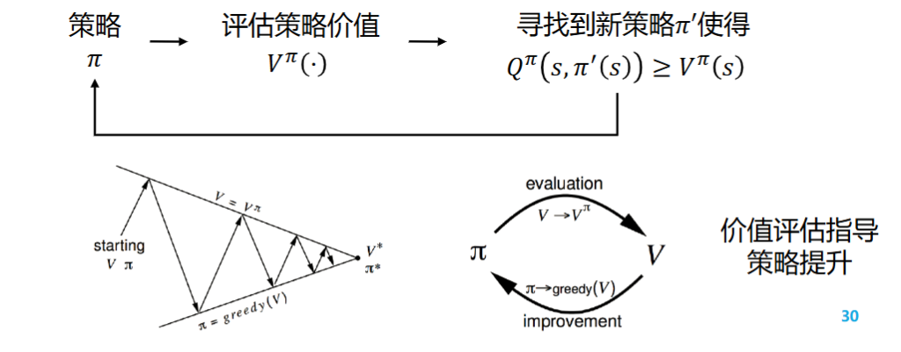

# 强化学习基础理论

<!-- 在这里填写文章摘要，摘要将显示在 Blog 列表中。 -->

<!-- more -->

## 路线图

<figure class="rl-roadmap-figure">
--8<-- "docs/blog/posts/post-training/assets/rl-basics/rl-roadmap.svg"
<figcaption>两条主线：基于价值的方法逐步去掉对模型的依赖，最后用神经网络近似 Q；基于策略的方法直接优化策略，并借用 TD 学到的价值函数作为 Critic。</figcaption>
</figure>

## 基本概念：智能体、环境与 MDP

RL 解决的是决策问题。监督学习从给定的 data 里学一个映射，模型的输出不会影响之后看到的数据；而 RL 中 Agent 的 action 会改变环境的 state，进而影响之后所有能拿到的 reward。所以 RL 学的不是去拟合标签，而是一个策略，目标是在长期交互中最大化累积奖励的期望。

### 交互框架

<figure class="rl-roadmap-figure">
--8<-- "docs/blog/posts/post-training/assets/rl-basics/rl-loop.svg"
<figcaption>Agent 在 <i>S</i>t 下按策略选 <i>A</i>t，环境返回 <i>S</i>t+1 和 <i>R</i>t+1。</figcaption>
</figure>

每个时间步 $t$，Agent 观察到状态 $S_t$，选择动作 $A_t$，环境转移到 $S_{t+1}$ 并给出奖励 $R_{t+1}$。不断重复这个过程，就得到一条轨迹（trajectory）：

$$
\tau = (S_0, A_0, R_1, S_1, A_1, R_2, \dots)
$$

策略（policy）$\pi(a\mid s)$ 表示在状态 $s$ 下选择动作 $a$ 的概率，确定性策略可以写成 $a=\pi(s)$。奖励 $R_{t+1}$ 只评价单步动作的好坏，而决策关心的是长期收益，因此定义从 $t$ 时刻开始的回报（return）：

$$
G_t = R_{t+1} + \gamma R_{t+2} + \gamma^2 R_{t+3} + \dots = \sum_{k=0}^{\infty} \gamma^k R_{t+k+1}
$$

RL 的目标就是找到使期望回报最大的策略 $\pi^* = \arg\max_{\pi} \mathbb{E}_{\tau \sim \pi}[G_0]$。

### 为什么用 MDP

如果下一个状态依赖于全部历史 $S_1,\dots,S_t$，那么随着交互进行，需要考虑的信息会越来越长，没法处理。MDP 假设环境的转移满足马尔可夫性质：

$$
\mathbb{P}[S_{t+1}\mid S_t] = \mathbb{P}[S_{t+1}\mid S_1, \dots, S_t]
$$

即当前状态是未来的充分统计量，知道 $S_t$ 之后历史就可以丢掉了。这也是后面贝尔曼方程能写成一步递推的前提。

MDP 可以由一个五元组 $(S, A, P_{sa}, \gamma, R)$ 表示：

- $S$ 是状态的集合，比如迷宫中的位置、Atari 游戏中的当前屏幕
- $A$ 是动作的集合，比如向 N、E、S、W 移动，手柄操纵杆方向和按钮
- $P_{sa}$ 是状态转移概率：对每个 $s\in S$ 和 $a\in A$，$P_{sa}$ 是下一个状态在 $S$ 上的概率分布
- $\gamma\in[0,1]$ 是对未来奖励的折扣因子
- $R: S\times A \mapsto \mathbb{R}$ 是奖励函数，有时奖励只和状态相关，写作 $R(s)$

## 价值函数与贝尔曼方程

RL 的目标是找 $\pi^* = \arg\max_\pi \mathbb{E}_{\tau\sim\pi}[G_0]$，但直接在所有策略里搜是不现实的。更自然的思路是迭代：先拿一个策略 $\pi$，评估它好不好（策略评估，policy evaluation），再根据评估结果改进它（策略提升，policy improvement），反复进行直到不能再改进为止。

### 策略评估：为什么需要价值函数

$\mathbb{E}[G_0]$ 只是一个标量，它能告诉我们策略整体有多好，但不知道该在哪里改。要改进策略，需要知道每个状态下按 $\pi$ 走下去能拿到多少回报，这就是状态价值函数：

$$
V_\pi(s) = \mathbb{E}_\pi[G_t \mid S_t = s]
$$

只有 $V_\pi$ 还不够，因为改进策略要比较不同动作，所以再定义动作价值函数，表示在 $s$ 先执行 $a$、之后按 $\pi$ 行动的期望回报：

$$
Q_\pi(s,a) = \mathbb{E}_\pi[G_t \mid S_t = s, A_t = a]
$$

两者的关系是 $V_\pi(s) = \sum_a \pi(a\mid s)\,Q_\pi(s,a)$，即 $V$ 是 $Q$ 在策略下的平均。$A_\pi(s,a) = Q_\pi(s,a) - V_\pi(s)$ 称为优势函数（advantage），衡量动作 $a$ 比平均水平好多少，后面策略梯度会用到。

### 策略提升：有了 Q 怎么改

有了 $Q_\pi$，改进的方式很直接：每个状态都选当前看来最好的动作

$$
\pi'(s) = \arg\max_a Q_\pi(s,a)
$$

策略提升定理保证这样做不会变差：若对所有 $s$ 有 $Q_\pi(s,\pi'(s)) \ge V_\pi(s)$，则 $V_{\pi'}(s) \ge V_\pi(s)$。贪心策略显然满足条件，因为 $\max_a Q_\pi(s,a)$ 不小于按 $\pi$ 的平均 $V_\pi(s)$。

不断交替进行价值评估与贪心策略提升，最终就能逼近最优的 $V^*$ 和 $\pi^*$。所以现在的问题归结为：如何求解出 $V_\pi$ 和 $Q_\pi$，有了它们就可以直接用来决策。

### 贝尔曼期望方程：怎么算价值函数

按定义直接算，要对所有可能的轨迹求期望。但回报本身有递推结构 $G_t = R_{t+1} + \gamma G_{t+1}$，再加上马尔可夫性质（未来只依赖 $S_{t+1}$），就能把价值写成"一步奖励 + 下一状态价值"。用 backup 图表示就是往下展开一层再求平均：

<figure class="rl-roadmap-figure">
--8<-- "docs/blog/posts/post-training/assets/rl-basics/bellman-backup.svg"
<figcaption>空心圆是状态，实心点是动作。V 先按 π 对动作平均，再按 P 对下一状态平均；Q 反过来。</figcaption>
</figure>

$$
V_\pi(s) = \sum_a \pi(a\mid s)\Big[R(s,a) + \gamma \sum_{s'} P_{sa}(s')\,V_\pi(s')\Big]
$$

$$
Q_\pi(s,a) = R(s,a) + \gamma \sum_{s'} P_{sa}(s') \sum_{a'} \pi(a'\mid s')\,Q_\pi(s',a')
$$

这就是贝尔曼期望方程。它把对整条轨迹的期望变成了状态之间的一步递推关系，有限状态下就是一个线性方程组，策略评估就是在解这个方程。

### 贝尔曼最优方程

评估和提升不断交替，最终收敛到最优策略 $\pi^*$，对应最优价值 $V^*(s) = \max_\pi V_\pi(s)$、$Q^*(s,a) = \max_\pi Q_\pi(s,a)$。此时策略已经是贪心的，期望方程中对 $\pi$ 的平均变成取 max：

$$
V^*(s) = \max_a \Big[R(s,a) + \gamma \sum_{s'} P_{sa}(s')\,V^*(s')\Big]
$$

$$
Q^*(s,a) = R(s,a) + \gamma \sum_{s'} P_{sa}(s') \max_{a'} Q^*(s',a')
$$

知道 $Q^*$ 后，最优策略就是 $\pi^*(s) = \arg\max_a Q^*(s,a)$。因为有 max，这个方程是非线性的，没有闭式解，只能迭代求解。在 $P_{sa}$ 和 $R$ 已知时，可以用下一节的动态规划求解。

## 动态规划：策略迭代与价值迭代

当 $P_{sa}$ 和 $R$ 都已知时（model-based），贝尔曼方程中的每一项都能直接算，不需要和环境交互。动态规划（Dynamic Programming, DP）的做法就是把贝尔曼方程当成更新式，反复迭代直到收敛。

### 策略迭代

策略迭代就是把前面"评估 → 提升"的循环直接落地：

1. 策略评估：固定 $\pi$，用贝尔曼期望方程反复更新所有状态，直到 $V_k$ 收敛到 $V_\pi$

    $$
    V_{k+1}(s) \leftarrow \sum_a \pi(a\mid s)\Big[R(s,a) + \gamma \sum_{s'} P_{sa}(s')\,V_k(s')\Big]
    $$

2. 策略提升：用 $V_\pi$ 算出 $Q_\pi(s,a) = R(s,a) + \gamma \sum_{s'} P_{sa}(s')V_\pi(s')$，再贪心地取 $\pi'(s) = \arg\max_a Q_\pi(s,a)$

重复这两步，直到策略不再变化。有限 MDP 中策略数量有限，而每次提升都不会变差，所以一定会收敛到 $\pi^*$。

### 价值迭代

策略迭代每一轮都要把评估跑到收敛，代价很大。实际上评估没必要算准，只更新一步就提升策略也可以收敛。把这两步合在一起，就是直接迭代贝尔曼最优方程：

$$
V_{k+1}(s) \leftarrow \max_a \Big[R(s,a) + \gamma \sum_{s'} P_{sa}(s')\,V_k(s')\Big]
$$

收敛得到 $V^*$ 后，再做一次贪心就能得到 $\pi^*$。

DP 的问题在于强依赖环境模型。大多数实际场景中根本不知道 $P_{sa}$，贝尔曼方程里对下一状态的期望 $\sum_{s'}P_{sa}(s')[\cdot]$ 也就没法算；而且每次都要遍历全部状态，状态空间一大就做不了。

## 蒙特卡洛与时序差分

不知道 $P_{sa}$ 时（model-free），只能让 Agent 按策略和环境交互，用采样出的数据去近似期望。思路仍然是"评估 → 提升"，只是两步都要改成基于样本的版本。

### 策略评估：用样本估计价值

蒙特卡洛（Monte Carlo, MC）直接从定义 $V_\pi(s) = \mathbb{E}_\pi[G_t \mid S_t = s]$ 出发，期望用样本平均代替。按 $\pi$ 跑完一整条轨迹，得到真实回报 $G_t$，用它更新 $V(S_t)$：

$$
V(S_t) \leftarrow V(S_t) + \alpha\big(G_t - V(S_t)\big)
$$

其中 $\alpha$ 为学习率。$G_t$ 是 $V_\pi(S_t)$ 的无偏估计，但它累积了整条轨迹上所有动作和转移的随机性，方差很大，而且必须等 episode 结束才能更新。

时序差分（Temporal Difference, TD）结合了 MC 与 DP 的思想：像 MC 一样采样，不需要模型；像 DP 一样利用贝尔曼方程做一步 bootstrapping。只交互一步得到 $(R_{t+1}, S_{t+1})$，后面的回报用当前估计 $V(S_{t+1})$ 代替：

$$
V(S_t) \leftarrow V(S_t) + \alpha\big(R_{t+1} + \gamma V(S_{t+1}) - V(S_t)\big)
$$

其中 $R_{t+1} + \gamma V(S_{t+1})$ 称为 TD target，$\delta_t = R_{t+1} + \gamma V(S_{t+1}) - V(S_t)$ 称为 TD error。由于 $V(S_{t+1})$ 本身是估计值，TD target 是有偏的；但它只包含一步的随机性，方差比 MC 小得多，并且每走一步就能在线更新。

两者之间还可以折中：往后看 $n$ 步真实奖励再接 $\gamma^n V(S_{t+n})$，就是 $n$-step TD；对不同 $n$ 的回报做指数加权平均，就是 TD($\lambda$)。后面 Actor-Critic 中的 GAE 也是同样的思路。

### 策略提升：从数据中改进策略

有了样本估计的价值函数，下一步是提升策略。但 model-free 下只学 $V$ 是不够的：贪心提升需要 $\arg\max_a \big[R(s,a) + \gamma\sum_{s'}P_{sa}(s')V(s')\big]$，这里又用到了未知的 $P_{sa}$。所以要直接估计 $Q(s,a)$，提升时只需要 $\pi'(s) = \arg\max_a Q(s,a)$，不再依赖模型。

另一个问题是探索。数据是策略自己采出来的，如果每次都贪心选动作，没被选过的动作就永远没有样本，$Q$ 也永远估不准。常用的做法是 $\varepsilon$-greedy：以 $1-\varepsilon$ 的概率选 $\arg\max_a Q(s,a)$，以 $\varepsilon$ 的概率随机选一个动作。

把 TD 的思想用到 $Q$ 上，每交互一步就更新一次 $Q$，并用 $\varepsilon$-greedy 采集下一步数据，就得到两个经典算法。

SARSA 用实际采样到的下一个动作 $A_{t+1}$ 构造 TD target，更新所需的五元组 $(S_t, A_t, R_{t+1}, S_{t+1}, A_{t+1})$ 也是名字的由来：

$$
Q(S_t, A_t) \leftarrow Q(S_t, A_t) + \alpha\big(R_{t+1} + \gamma Q(S_{t+1}, A_{t+1}) - Q(S_t, A_t)\big)
$$

它对应贝尔曼期望方程，估计的是当前 $\varepsilon$-greedy 策略自身的 $Q_\pi$，采样和学习的是同一个策略，属于 on-policy。

Q-learning 不管下一步实际选了什么动作，直接用 $\max_{a'}$ 构造 TD target：

$$
Q(S_t, A_t) \leftarrow Q(S_t, A_t) + \alpha\big(R_{t+1} + \gamma \max_{a'} Q(S_{t+1}, a') - Q(S_t, A_t)\big)
$$

它对应贝尔曼最优方程，直接逼近 $Q^*$。采样用的是 $\varepsilon$-greedy 策略，学习的却是贪心策略，属于 off-policy，因此也可以用其他策略或历史数据来学习。

当状态空间很大时（比如 Atari 的屏幕像素），$Q$ 没法用表格存下，就需要用神经网络 $Q_\theta(s,a)$ 来近似，这就是 DQN。

## 策略梯度

<!-- 策略梯度定理、REINFORCE、baseline 与方差缩减、重要性采样。 -->

## Actor-Critic

## 信任域方法：TRPO 与 PPO

## 从 RL 到 LLM 后训练

<!-- RLHF、GRPO 等方法与经典 RL 的对应关系。 -->

## 总结

## 参考资料

- [David Silver：UCL Course on Reinforcement Learning](https://davidstarsilver.wordpress.com/teaching/)
- [动手学强化学习](https://hrl.boyuai.com/)

<!-- 本文配图放在 assets/rl-basics/ 下，用相对路径引用。 -->
