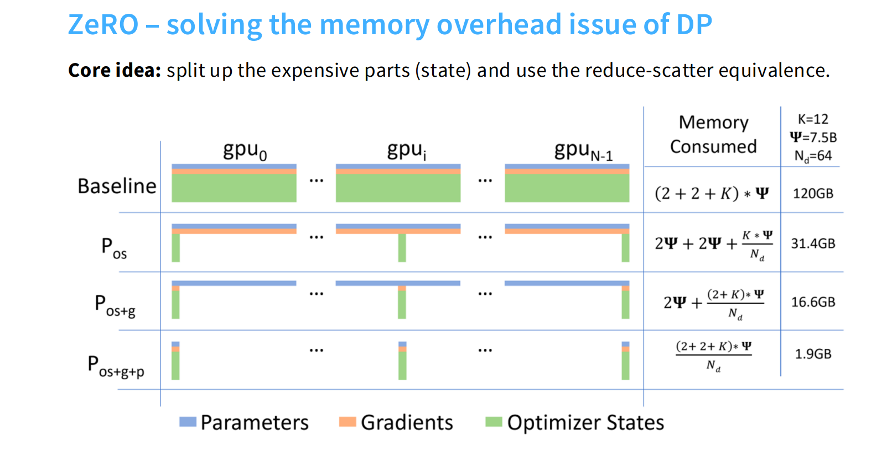
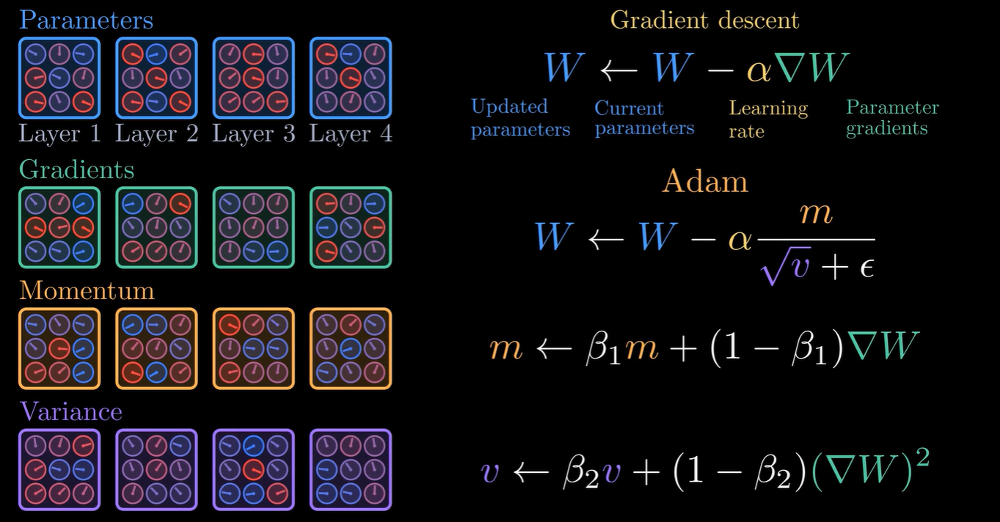
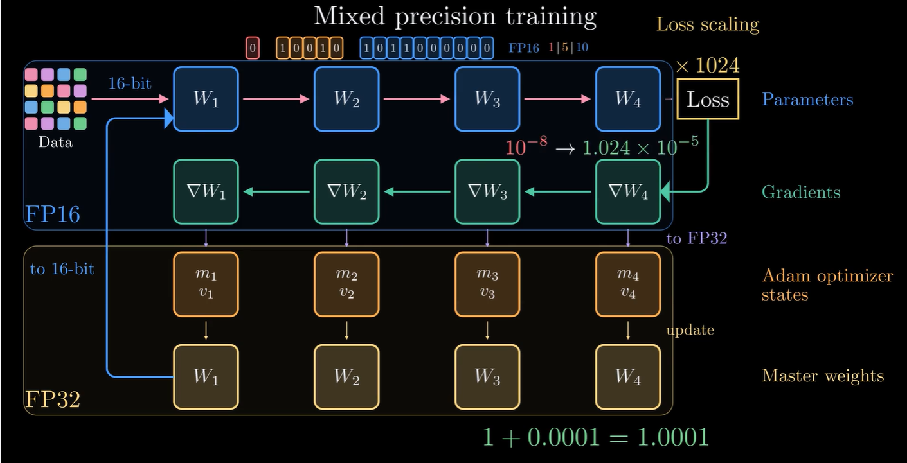
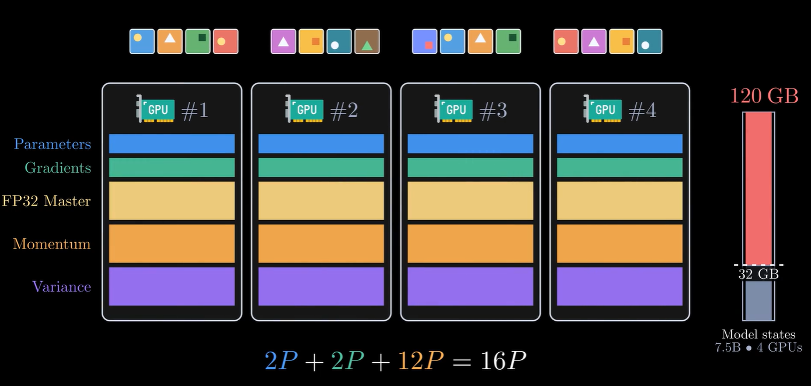
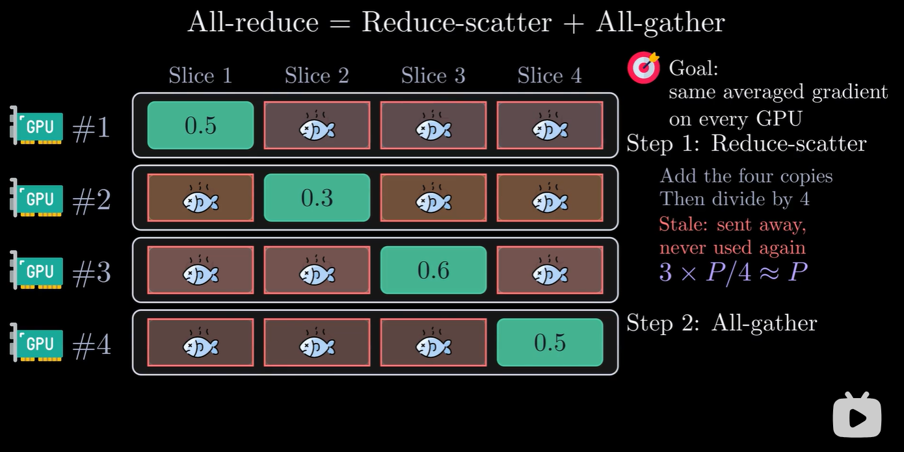
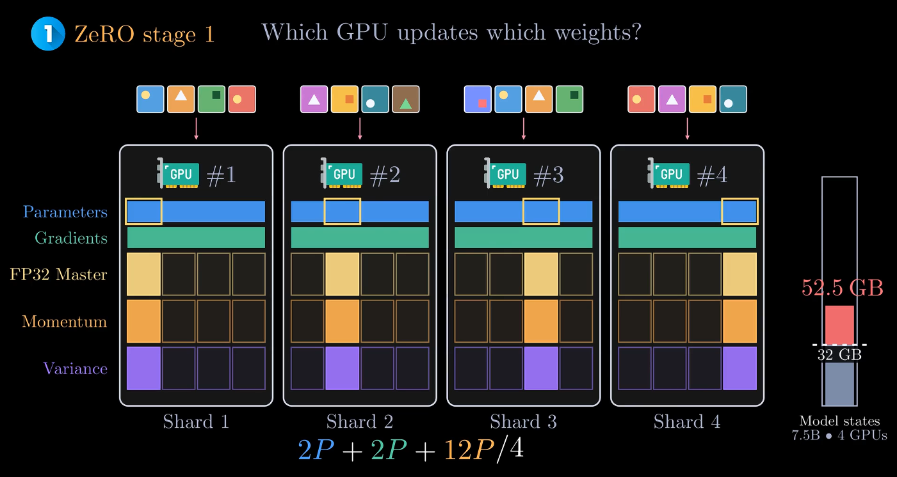
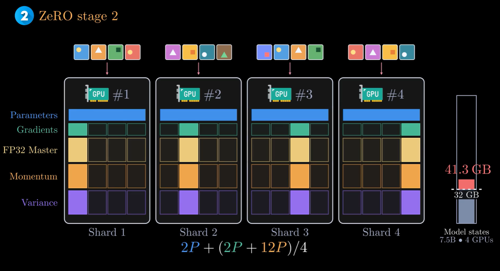
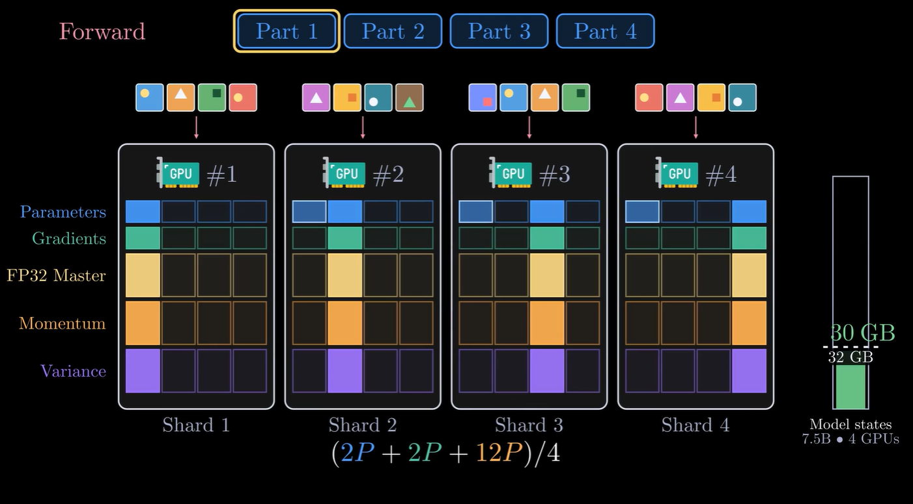
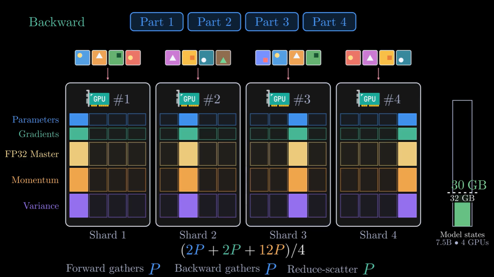

# 大模型并行训练技术之ZERO系列

Adam + 混合精度下，$\Psi$ 个参数的模型状态占 $16\Psi$ 字节，DP 中每张卡各存一份。ZeRO 把这些状态切成 $N$ 片，每张卡只存自己那一片：ZeRO-1 切优化器状态，ZeRO-2 再切梯度，ZeRO-3 再切参数。

<!-- more -->

| 方法 | 切分对象 | 单卡显存 | $\Psi=7.5\text{B}, N=64$ | 单卡通信量 |
| --- | --- | --- | --- | --- |
| DP | — | $16\Psi$ | 120 GB | $2\Psi$ |
| ZeRO-1（$P_{os}$） | 优化器状态 | $4\Psi + \frac{12\Psi}{N}$ | 31.4 GB | $2\Psi$ |
| ZeRO-2（$P_{os+g}$） | + 梯度 | $2\Psi + \frac{14\Psi}{N}$ | 16.6 GB | $2\Psi$ |
| ZeRO-3（$P_{os+g+p}$） | + 参数 | $\frac{16\Psi}{N}$ | 1.9 GB | $3\Psi$ |

## 背景

### Adam 的 4 种状态

Adam 除了参数 $W$ 和梯度 $\nabla W$，还为每个参数维护一阶矩 $m$ 和二阶矩 $v$：

$$
\begin{aligned}
m &\leftarrow \beta_1 m + (1-\beta_1)\nabla W \\
v &\leftarrow \beta_2 v + (1-\beta_2)(\nabla W)^2 \\
W &\leftarrow W - \alpha \frac{m}{\sqrt{v}+\epsilon}
\end{aligned}
$$

$m$、$v$ 只在 optimizer step 时使用，称为**优化器状态**。

### 混合精度训练

前向和反向用 FP16 的 $W$ 与 $\nabla W$；优化器在 FP32 下更新一份 **Master Weights**，再 cast 回 FP16。保留 FP32 是为了解决两个精度问题：

1. **梯度下溢**：FP16 最小正数约 $6\times10^{-8}$，更小的梯度变成 0。用 **Loss Scaling** 先放大 loss（如 $\times 1024$），更新前再除回。
2. **更新被吞掉**：FP16 在 1 附近的间隔约 $10^{-3}$，$1 + 0.0001 = 1$。在 FP32 上累积更新才不会丢失。

### DP 的显存开销

| 状态 | 精度 | 字节 / 参数 |
| --- | --- | --- |
| Parameters | FP16 | 2 |
| Gradients | FP16 | 2 |
| Master Weights | FP32 | 4 |
| Momentum | FP32 | 4 |
| Variance | FP32 | 4 |
| **合计** | | **16** |

其中 FP32 的 $12\Psi$（即图中的 $K\Psi$，$K=12$）是优化器状态。7.5B 模型需要 120GB，DP 中每张卡都存一份。这里只讨论模型状态，不含激活值等 residual states。

## 核心思路：All-reduce = Reduce-scatter + All-gather

DP 用 All-reduce 同步梯度，Ring All-reduce 本身由两步组成：

1. **Reduce-scatter（RS）**：梯度切成 $N$ 片，第 $i$ 张卡得到第 $i$ 片的平均梯度，其余 $N-1$ 片不再有用。
2. **All-gather（AG）**：各卡广播自己那片，拼回完整梯度。

每一步中，每张卡都要发出 $N-1$ 片、每片 $\Psi/N$。图中 $N=4$，RS 和 AG 的单卡通信量各为 $\frac{3}{4}\Psi$：

| 原语 | 单卡通信量 | 图中（$N=4$） |
| --- | --- | --- |
| Reduce-scatter | $\frac{N-1}{N}\Psi$ | $\frac{3}{4}\Psi$ |
| All-gather | $\frac{N-1}{N}\Psi$ | $\frac{3}{4}\Psi$ |
| All-reduce = RS + AG | $\frac{2(N-1)}{N}\Psi$ | $\frac{3}{2}\Psi$ |

$N$ 较大时 $\frac{N-1}{N}\to 1$，所以 DP 每张 GPU 每个 step 的通信量约为 $2\Psi$。

关键在 RS 之后：第 $i$ 张卡只有第 $i$ 片有效梯度。如果它只负责更新第 $i$ 片参数，就既不需要完整梯度，也不需要完整的优化器状态。于是 ZeRO 把 AG 从梯度挪到了更新后的参数上：

$$
\underbrace{\text{RS(梯度)} + \text{AG(梯度)}}_{\text{DP: } 2\Psi} \quad\Longrightarrow\quad \underbrace{\text{RS(梯度)} \to \text{更新本卡 } 1/N \to \text{AG(参数)}}_{\text{ZeRO-1/2: } 2\Psi}
$$

通信量不变，每张卡的状态只需存 $1/N$。

## ZeRO-1：切分优化器状态

$12\Psi$ 的优化器状态切成 $N$ 片，第 $i$ 张卡只存、只更新第 $i$ 片；FP16 参数和梯度仍是完整的。一个 step：

1. 前向 + 反向，得到完整的 FP16 梯度。
2. RS 梯度，拿到第 $i$ 片平均梯度（$\Psi$）。
3. 用本地 $m_i, v_i$ 更新第 $i$ 片 Master Weights，cast 为 FP16。
4. AG 参数，拼回完整 FP16 参数（$\Psi$）。

显存 $4\Psi + \frac{12\Psi}{N}$，$N$ 大时趋近 $4\Psi$，约 **4 倍**节省；通信 $2\Psi$，与 DP 相同。

## ZeRO-2：再切分梯度

ZeRO-2 不改变通信，只省显存，利用的是**反向传播逐层计算**这一点。

反向从最后一层往前算，第 $l$ 层的梯度一旦算出，本 step 内就不会再变。所以不必等整个反向结束再统一做 RS：

1. 第 $l$ 层（实际按 bucket 分组）的梯度算完，立即做 RS。
2. 只保留本卡负责的那 $1/N$，其余立即释放。
3. 同时继续算第 $l-1$ 层，RS 通信与反向计算重叠。

ZeRO-1 要等反向结束才 RS，显存中会有完整的 $2\Psi$ 梯度；ZeRO-2 中任意时刻只有本卡的 $\frac{2\Psi}{N}$ 加一个正在通信的 bucket。

显存 $2\Psi + \frac{14\Psi}{N}$：7.5B、4 卡为 41.3GB，仍放不进 32GB；$N$ 大时约 **8 倍**节省。RS 只是提前到反向中进行，通信仍为 $2\Psi$（RS 梯度 + AG 参数）。

## ZeRO-3：再切分参数

ZeRO-2 之后，每张卡上剩下的冗余只有完整的 FP16 参数 $2\Psi$。ZeRO-3 的出发点是：**前向和反向都是逐层计算的，任意时刻只需要当前这一层的完整参数**。所以参数也可以切成 $1/N$ 常驻，算到哪一层再临时收集哪一层。

### 前向：用到哪层，收集哪层

对每一层 $l$：

1. AG 收集第 $l$ 层的完整参数。
2. 计算第 $l$ 层的前向。
3. 丢弃非本卡的参数片，只留自己的 $1/N$。

所有层走完，累计 AG 了一份完整参数，即图中的 “Forward gathers P”（$\Psi$）。

### 反向：再收集一次参数，梯度边算边 RS

前向结束后参数已经丢掉，反向计算梯度时还要用，只能再收集一次。从最后一层往前，对每一层 $l$：

1. AG 收集第 $l$ 层的完整参数（“Backward gathers P”，累计 $\Psi$）。
2. 计算第 $l$ 层的梯度，然后丢弃非本卡的参数片。
3. 与 ZeRO-2 相同，梯度算完立即 RS，只留本卡的 $1/N$（“Reduce-scatter P”，累计 $\Psi$）。

### 更新

每张卡用本卡的梯度片和优化器状态，直接更新本卡的参数片。参数本来就是切分存储的，**不需要 ZeRO-1/2 最后那次 AG**，下一个 step 前向时再按需收集。

### 开销

- **显存**：$\frac{16\Psi}{N}$，加上同一时刻正在使用的一两层完整参数。7.5B、4 卡为 30GB，终于放进 32GB；显存随 $N$ **线性**下降。
- **通信**：前向 AG $\Psi$ + 反向 AG $\Psi$ + 梯度 RS $\Psi$ = $3\Psi$，是 DP 的 1.5 倍。多出来的 $\Psi$ 来自反向又收集了一遍参数。
- **掩盖通信**：计算第 $l$ 层时预取第 $l+1$ 层（反向时是 $l-1$ 层）的参数，让 AG 与计算重叠。

## 总结

- **ZeRO-1**：RS 后每张卡只更新 $1/N$ 权重 → 只存 $1/N$ 优化器状态。
- **ZeRO-2**：RS 后其余梯度不再使用 → 只存 $1/N$ 梯度。
- **ZeRO-3**：参数只在计算时需要完整 → 只存 $1/N$ 参数，用时 AG。

ZeRO-1/2 不增加通信，分别省约 4 倍和 8 倍显存；ZeRO-3 多 50% 通信，换来随卡数线性下降的显存。

表面上看，FSDP（即 ZeRO-3）在计算时确实会把完整参数加载到 GPU 中，那它为什么能节省显存呢？关键在于**时间差**和**计算粒度**：

- **时间差（即用即弃）**：在计算某层时，确实会通过 AllGather 操作重建完整参数，但计算完成后立即释放这些临时聚合的参数。DP 中完整参数从头到尾常驻，ZeRO-3 中每层的完整参数只是短暂出现。
- **计算粒度**：收集的单位是一层（FSDP 中是一个 FSDP unit），不是整个模型。同一时刻显存中只有当前层（加上预取的下一层）的完整参数。

所以 ZeRO-3 的显存峰值是 $\frac{16\Psi}{N}$ 加上一两层的完整参数，而不是 $16\Psi$。模型层数越多，单层占比越小，这部分额外开销就越可以忽略。

在分布式训练中，为了解决单卡显存不足和计算效率的问题，有两条主要的技术路线：一条是以 FSDP 为代表，通过切分模型的状态来解决内存问题；另一条则是以 Megatron-LM 为代表，通过切分模型的计算来解决内存问题。

## 参考资料

- Rajbhandari et al. *ZeRO: Memory Optimizations Toward Training Trillion Parameter Models*. SC 2020. [arXiv:1910.02054](https://arxiv.org/abs/1910.02054)
- Micikevicius et al. *Mixed Precision Training*. ICLR 2018. [arXiv:1710.03740](https://arxiv.org/abs/1710.03740)
- [DeepSpeed ZeRO 文档](https://www.deepspeed.ai/tutorials/zero/)
