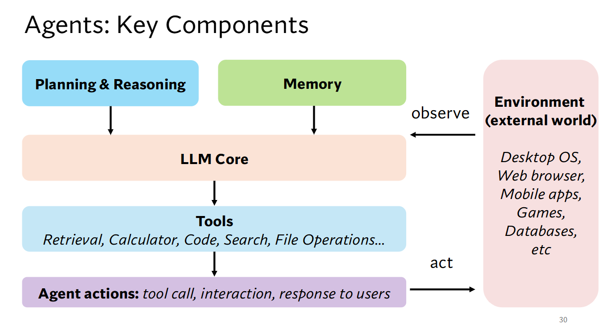
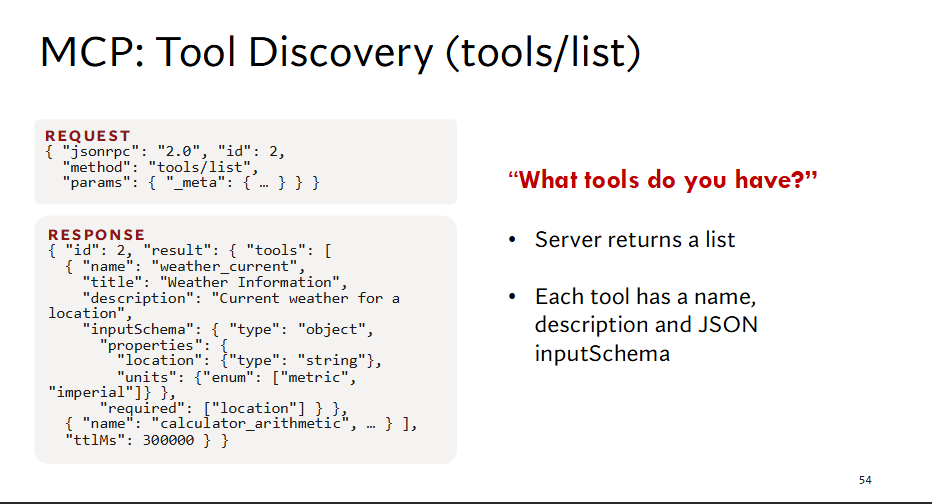
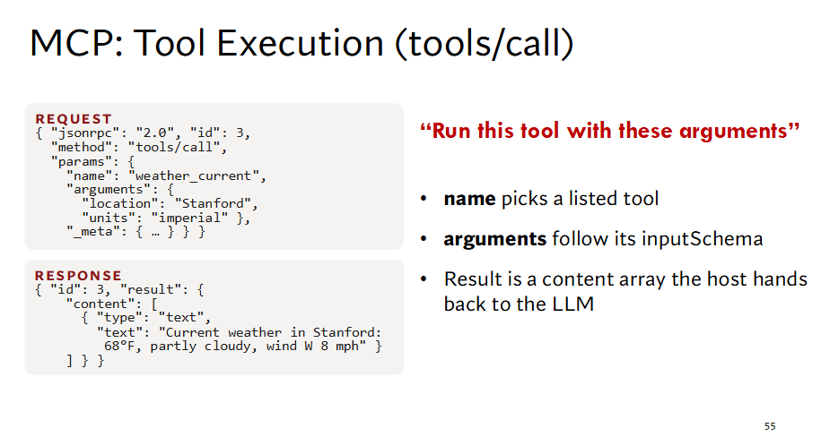

# CS329Z Lectures

## Lecture 1 · Introduction — What Are Agentic Systems? {#lecture-1}

### Agent 的组成



### 课程结构

课程按 Agent 的组成部件展开，再用数据、优化与评测改进它，最后落到安全与应用：

<div class="topic-map-scroll" tabindex="0" role="region" aria-label="CS329Z 课程地图，可横向滚动"><object class="topic-map" type="image/svg+xml" data="../assets/diagrams/course-map.svg" style="aspect-ratio: 1110 / 680">CS329Z 课程地图</object></div>

### 复合 AI 系统、Workflow 与 Agent

- **复合 AI 系统（Compound AI Systems）**：由多个组件（模型调用、检索器、外部工具等）组合而成的系统，而不是单个模型。
- **Workflow**：控制流写在代码里，LLM 只在固定步骤中被调用（分类、阅读、写作）。代码是司机，LLM 是工具。
- **Agent**：由模型决定下一步调用什么工具、何时结束，但它运行在代码搭建的循环之中。LLM 是司机，代码是车。

#### Agent 循环

Agent 的循环本身是一段固定的代码，称为 **harness（脚手架）**：

```python
messages = [system_prompt, user_request]

while turns < MAX_TURNS and tokens_used < TOKEN_BUDGET:   # 代码定边界：轮数、预算
    reply = lm(messages, tools=TOOLS)                     # 模型决定下一步
    messages.append(reply)

    if not reply.tool_calls:                              # 模型决定结束
        break

    for call in reply.tool_calls:
        if call.name in NEEDS_APPROVAL and not ask_user(call):
            result = "用户拒绝了该操作"                    # 高风险操作先请用户审批
        elif violates_guardrail(call):
            result = "该操作违反安全策略，已拒绝"            # 护栏拦截危险调用
        else:
            result = execute(call)                        # 由代码真正执行工具
        messages.append(tool_result(call, result))        # 观察结果回到上下文

    if count_tokens(messages) > CONTEXT_LIMIT:
        messages = compact(messages)                      # 上下文过长时压缩

    turns += 1
```

模型只负责选工具、填参数、决定何时停止；预算、审批、护栏、执行和上下文压缩都由代码负责。即：**模型在里面做决定，代码在外面兜底。**

### 关键挑战

- **可靠性（Reliability）**：多步执行中错误会累积，单步 95% 的成功率在 20 步后只剩约 36%。
- **训练（Training）**：如何获取 Agent 轨迹数据，并通过 SFT / RL 让模型更会“做事”。
- **安全（Safety）**：Agent 能调用工具、修改环境，带来提示注入、隐私泄露、越权操作等风险。
- **评测（Evaluation）**：任务开放、环境复杂、结果非确定，如何公平地衡量 Agent 的能力与成本。

## Lecture 2 · Tool Use & Function Calling {#lecture-2}

### 提供 Tool Use 的方法

| 思路 | 方法 | 做法 |
| --- | --- | --- |
| 改模型，去适应工具 | Toolformer、ToolkenGPT、Gorilla | 用 API 数据训练或微调模型 |
| 改工具的描述方式，让任何模型都能用 | Prompt、REST、Function Calling、MCP | 运行时把工具的 schema 传给模型，不需要训练 |

### 为什么需要标准接口

- **训练的方式扩展不了**：每接入一个新 API，就要多训练一次。
- **标准接口在运行时描述工具**：工具用 schema 写清名称、描述和参数，任何模型读到就能调用；接入新工具只需写一份 schema。
- **MCP 统一了协议**：工具封装成独立的 MCP server，任何客户端都能接入，写一次、到处复用。

### MCP 的两个核心调用

MCP 基于 JSON-RPC，宿主程序（MCP Client）在 LLM 和 MCP Server 之间转发：

```text
LLM ←→ 宿主程序（MCP Client） ── tools/list ──→ MCP Server
                              ── tools/call ──→
                              ←── content ─────
```

#### tools/list：发现工具

客户端问“你有哪些工具”，server 返回工具列表，每个工具包含 `name`、`description` 和 `inputSchema`（参数的 JSON Schema）。



#### tools/call：执行工具

客户端请求“用这些参数运行这个工具”：`name` 从列表中选一个工具，`arguments` 按其 `inputSchema` 填写。server 返回 `content` 数组，宿主程序再把它交还给 LLM。



## Lecture 9 · Optimization {#lecture-9}

有了数据、系统和评测，就可以用优化把系统适配到具体场景（last-mile adaptation）。优化对象分为上下文（prompt、few-shot）和权重，也可以让 Agent 自己当优化器。

<div class="topic-map-scroll" tabindex="0" role="region" aria-label="Lecture 9 优化思维导图，可横向滚动"><object class="topic-map" type="image/svg+xml" data="../assets/diagrams/l9-optimization.svg" style="aspect-ratio: 1040 / 860">Lecture 9 优化思维导图</object></div>
